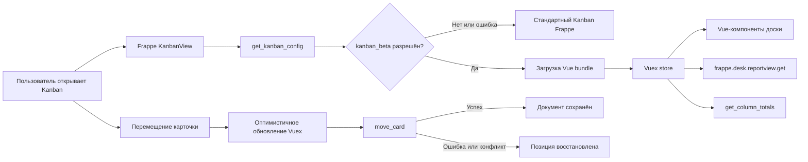

# Dinext Kanban

## Обзор

Dinext Kanban — приложение для Frappe Framework, которое дополняет стандартное Kanban-представление интерфейсом на Vue 3. Репозиторий называется `dinext_kanban`, а внутреннее имя устанавливаемого Frappe-приложения — `quick_kanban`.

Новый интерфейс включается конфигурацией сайта и может быть доступен всем пользователям либо заданному списку. Если конфигурацию или frontend bundle загрузить не удаётся, приложение возвращается к стандартному Kanban Frappe.

## Возможности

- Vue-интерфейс для Kanban Board любого DocType, использующего поле типа `Select`.
- Виртуализация карточек и постраничная загрузка по колонкам для больших досок.
- Начальная загрузка до 100 записей и автоматическая дозагрузка по 30 карточек при прокрутке отдельной колонки.
- Перемещение карточек мышью и через доступное с клавиатуры меню выбора колонки.
- Оптимистичное обновление с откатом при недостаточных правах, ошибке валидации или конкурентном изменении документа.
- Проверка прав чтения и записи на уровне DocType и поля.
- Подсчёт общего количества карточек в каждой колонке с учётом текущих фильтров.
- Настройка цвета колонок и выделение значений выбранного поля.
- Просмотр и изменение назначенных пользователей через стандартный Assign To Dialog.
- Явные состояния загрузки, отсутствия данных и ошибки с повторным запросом.
- Санитизация форматированного содержимого карточек через DOMPurify.
- Обновление через стандартный lifecycle списка Frappe без дополнительной realtime-подписки.
- Безопасный переход на стандартный Kanban при ошибке запуска нового интерфейса.

## Требования

- Frappe Framework 15.
- Python 3.10 или новее.
- Node.js 24 и Yarn для сборки и frontend-проверок.
- Рабочий bench с Redis и MariaDB, настроенными согласно требованиям Frappe.
- Chromium для запуска browser-тестов Playwright.

## Установка

Из корня bench загрузите приложение из центрального репозитория Dinext:

```bash
bench get-app quick_kanban \
  https://dinext.gitlab.yandexcloud.net/erpnext/dinext/dinext_kanban.git
```

Установите его на нужный сайт:

```bash
bench --site <site-name> install-app quick_kanban
```

Соберите assets и очистите cache:

```bash
bench build --app quick_kanban
bench --site <site-name> clear-cache
```

## Конфигурация

Включите новый Kanban для всех пользователей сайта:

```bash
bench --site <site-name> set-config kanban_beta 1
```

Для поэтапного включения задайте список пользователей в `sites/<site-name>/site_config.json`:

```json
{
  "kanban_beta": 1,
  "kanban_beta_users": [
    "user@example.com",
    "manager@example.com"
  ]
}
```

Правила применения конфигурации:

- `kanban_beta = 0` или отсутствие параметра — используется стандартный Kanban Frappe;
- `kanban_beta = 1` и пустой `kanban_beta_users` — новый Kanban доступен всем;
- `kanban_beta = 1` и непустой `kanban_beta_users` — новый Kanban доступен только перечисленным пользователям.

## Использование

1. Создайте или откройте стандартный `Kanban Board` в Frappe.
2. Выберите целевой DocType и поле типа `Select`, значения которого станут колонками.
3. Добавьте поля, которые должны отображаться на карточке.
4. При необходимости задайте `Highlighted Field` и таблицу цветов для его значений.
5. Откройте Kanban-представление списка.

Карточку можно переместить drag-and-drop или через действие `Move to`. Изменение сохраняется серверным методом `quick_kanban.api.move_card`, который проверяет право записи, допустимость значения и метку последнего изменения документа.

## Технологии

- Frappe Framework 15 и Python — серверные методы, права и подключение assets.
- Vue 3 — компоненты доски.
- Vuex 4 — состояние, загрузка данных и оптимистичные операции.
- Vite — сборка frontend bundle.
- `vue-virtual-draglist` — виртуализация и drag-and-drop.
- DOMPurify — очистка форматированного HTML.
- Vitest и Vue Test Utils — модульные и компонентные тесты.
- Playwright — browser-тесты пользовательских сценариев.
- ESLint и Frappe Semgrep rules — статические проверки.

## Разработка и проверки

Установите frontend-зависимости из корня приложения:

```bash
yarn install --frozen-lockfile
```

Запустите frontend-проверки:

```bash
yarn workspace quick_kanban lint
yarn workspace quick_kanban test:run
yarn workspace quick_kanban test:browser
yarn workspace quick_kanban build
python3 -m compileall -q quick_kanban
```

Backend-тесты выполняются из корня bench:

```bash
bench --site <site-name> run-tests --app quick_kanban
```

Для локальной разработки frontend:

```bash
yarn dev
```

Frontend состоит из двух слоёв: `quick_kanban/public/js/kanban_view.bundle.js` расширяет стандартный `KanbanView`, а Vite собирает Vue-приложение из `Quick-Kanban/src/`. Команда сборки копирует JavaScript и CSS в `quick_kanban/public/`; сгенерированные bundles должны соответствовать исходникам перед передачей изменений на проверку.

## Участие в разработке

1. Ознакомьтесь с [AGENTS.md](AGENTS.md) и центральными правилами Dinext.
2. Создавайте изменения в отдельной ветке от актуальной целевой ветки.
3. Добавляйте тесты для нового поведения и исправленных регрессий.
4. Перед review запускайте lint, unit-тесты, browser-тесты, backend-тесты и сборку.
5. Не включайте в commit временные файлы, отчёты покрытия, Playwright artifacts и `node_modules`.

Pull request автоматически проверяется frontend/backend workflow и Frappe Semgrep rules.

## Локализация

Все пользовательские строки приложения оборачиваются в `_()` (Python) или `__()` (JavaScript) и сопровождаются русскими переводами в [`quick_kanban/translations/ru.csv`](quick_kanban/translations/ru.csv).

При добавлении новых строк:

1. Оберните текст в `_()` / `__()`.
2. Добавьте пару `"English","Русский",""` в `ru.csv`.
3. После изменения переводов выполните на сайте:

```bash
bench --site <site-name> migrate
bench --site <site-name> clear-cache
```

При необходимости синхронизируйте переводы через `bench update-translations` согласно процессу вашего bench.

## Документация

- [AGENTS.md](AGENTS.md) — navigation stub к общим инструкциям, skills и rules Dinext.
- [`../dinext-docs/catalog.md`](../dinext-docs/catalog.md) — центральный каталог пользовательской документации.
- [`../dinext-docs/docs/бизнес-функции/задачи/Задачи.md`](../dinext-docs/docs/бизнес-функции/задачи/Задачи.md) — пользовательская документация по задачам и Kanban.
- [`quick_kanban/api.py`](quick_kanban/api.py) — серверные методы подсчёта и перемещения карточек.
- [`Quick-Kanban/src/`](Quick-Kanban/src/) — исходный код Vue-интерфейса.

После каждого commit локальный `post-commit` hook формирует предложение для документации в `../dinext-docs/doc-proposals/inbox/`. Повторная установка hook:

```bash
python3 ../dinext-docs/scripts/install_doc_intake_hooks.py \
  --docs-root ../dinext-docs \
  --app-root . \
  --apply
```

## Благодарности

Приложение основано на открытом проекте [tridz-dev/quick_kanban](https://github.com/tridz-dev/quick_kanban). Развитие и интеграция в продукт Dinext ведутся в репозитории `dinext_kanban`.

## Структура репозитория

```text
dinext_kanban/
├── .github/workflows/          # CI: quality gates, Semgrep и release workflow
├── Quick-Kanban/
│   ├── e2e/                    # Playwright-сценарии и автономная browser fixture
│   ├── src/
│   │   ├── components/         # Vue-компоненты доски, колонок и карточек
│   │   ├── test/               # Общая настройка Vitest и тесты интеграционных scripts
│   │   ├── utils/              # Store, преобразование данных, меню и цвета
│   │   ├── App.vue             # Корневой Vue-компонент
│   │   ├── main.js             # Mount/unmount Vue-приложения
│   │   └── style.css           # Стили нового Kanban
│   ├── package.json            # Frontend-зависимости и команды
│   ├── playwright.config.js    # Конфигурация browser-тестов
│   └── vite.config.js          # Сборка и unit-тесты
├── quick_kanban/
│   ├── public/
│   │   ├── css/                # Собранные и подключаемые стили
│   │   └── js/                 # Bootstrap, KanbanView override и Vue bundle
│   ├── tests/                  # Backend-тесты Frappe
│   ├── api.py                  # Permission-aware API доски
│   ├── get_beta_users.py       # Чтение feature flags из site config
│   └── hooks.py                # Метаданные Frappe и подключение assets
├── AGENTS.md                   # Указатель на central dinext-docs
├── package.json                # Корневой Yarn workspace
├── pyproject.toml              # Python package metadata
├── yarn.lock                   # Зафиксированные frontend-зависимости
└── license.txt                 # Лицензия MIT
```

## Поток данных



## Лицензия

Проект распространяется по лицензии MIT. Полный текст находится в [license.txt](license.txt).
