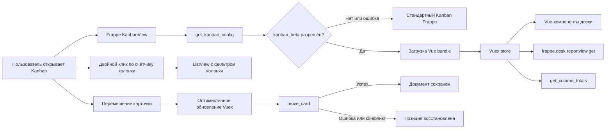

# Dinext Kanban

## 📖 Обзор

Dinext Kanban — приложение для Frappe Framework, которое дополняет стандартное Kanban-представление интерфейсом на Vue 3. Репозиторий называется `dinext_kanban`, а внутреннее имя устанавливаемого Frappe-приложения — `quick_kanban`.

Новый интерфейс включается конфигурацией сайта и может быть доступен всем пользователям либо заданному списку. Если конфигурацию или frontend bundle загрузить не удаётся, приложение возвращается к стандартному Kanban Frappe.

## ✨ Возможности

- Vue-интерфейс для Kanban Board любого DocType, использующего поле типа `Select`.
- Виртуализация карточек и постраничная загрузка по колонкам для больших досок.
- Начальная загрузка до 100 записей и автоматическая дозагрузка по 30 карточек при прокрутке отдельной колонки.
- Перемещение карточек мышью и через доступное с клавиатуры меню выбора колонки.
- Двухслойная валидация перемещений: фронтенд фильтрует назначения по Workflow-правам и обязательным полям (`reqd`, `mandatory_depends_on`), сервер повторяет проверки при сохранении.
- Подсветка разрешённых колонок при перетаскивании и блокировка запрещённых назначений.
- Выбор Workflow action, когда несколько переходов ведут в одну колонку.
- Оптимистичное обновление с откатом при недостаточных правах, ошибке валидации или конкурентном изменении документа.
- Проверка прав чтения и записи на уровне DocType и поля.
- Подсчёт общего количества карточек в каждой колонке с учётом текущих фильтров.
- Двойной клик по счётчику в заголовке колонки открывает ListView с фильтром этой колонки и сохранёнными фильтрами доски.
- Настройка цвета колонок и выделение значений выбранного поля.
- Сжатие колонок по ширине (меню **Сжать** / **Открыть**, двойной клик, auto-expand при задержке курсора во время DnD карточки); состояние хранится локально на доску.
- Скрытие колонок с доски через меню колонки (для пользователей с правом записи на `Kanban Board`); элемент **Добавить колонку** после последней видимой колонки возвращает скрытые колонки и добавляет новые из допустимых значений Select-поля доски.
- Расцветка карточек по полю `color` (fieldtype `Color`) в целевом DocType: цветная полоска слева и лёгкий tint фона.
- Просмотр и изменение назначенных пользователей через стандартный Assign To Dialog.
- Переход из диалога Kanban Settings к записи текущей Kanban Board.
- Режим **Минимизировать**: компактные карточки (заголовок, drag-handle, highlight, Move, assignees) с раскрытием по hover и сохранением плотности при DnD.
- Явные состояния загрузки, отсутствия данных и ошибки с повторным запросом.
- Санитизация форматированного содержимого карточек через DOMPurify.
- Обновление через стандартный lifecycle списка Frappe без дополнительной realtime-подписки.
- Безопасный переход на стандартный Kanban при ошибке запуска нового интерфейса.

## 🚀 Установка

Репозиторий называется `dinext_kanban`, но в bench приложение клонируется в каталог **`apps/quick_kanban`**, а Frappe app name — **`quick_kanban`**.

### Установка на новый сайт

Выполняйте шаги **строго в этом порядке** из корня bench (`<bench-root>`):

**1. Загрузить приложение**

```bash
cd <bench-root>

bench get-app quick_kanban \
  https://dinext.gitlab.yandexcloud.net/erpnext/dinext/dinext_kanban.git \
  --branch <branch-name>
```

Параметр `--branch` опционален (если не указан — default branch репозитория). Если каталог `apps/quick_kanban` уже существует и нужно заменить исходники, используйте `--overwrite` или вручную переключите remote и checkout нужной ветки в `apps/quick_kanban`.

**2. Установить frontend-зависимости**

```bash
cd apps/quick_kanban
yarn install --frozen-lockfile
```

**3. Установить приложение на сайт**

```bash
cd <bench-root>
bench --site <site-name> install-app quick_kanban
```

**4. Собрать frontend (два шага — оба обязательны)**

Frappe Desk отдаёт **хешированные** bundles из `quick_kanban/public/dist/` через `sites/assets/assets.json`. Одной сборки Vite недостаточно.

```bash
cd apps/quick_kanban
yarn workspace quick_kanban build

cd <bench-root>
bench build --app quick_kanban
```

Альтернатива второму шагу — Frappe esbuild напрямую:

```bash
cd apps/frappe && yarn run production --apps quick_kanban
```

**5. Применить изменения на сайте**

```bash
cd <bench-root>
bench --site <site-name> migrate
bench --site <site-name> clear-cache
bench restart
```

`migrate` подтягивает переводы из `quick_kanban/translations/`. `bench restart` нужен на production/staging bench с supervisor.

**6. Включить новый Kanban**

Без этого шага используется стандартный Kanban Frappe:

```bash
bench --site <site-name> set-config kanban_beta 1
bench --site <site-name> clear-cache
```

Для поэтапного включения см. раздел [Конфигурация](#-конфигурация).

**7. Проверка в браузере**

Откройте Kanban Board и выполните жёсткое обновление страницы (`Ctrl+Shift+R`), чтобы подтянуть новый bundle.

#### Краткий чеклист (новый сайт)

```bash
# 1–3: загрузка и install-app
bench get-app quick_kanban https://dinext.gitlab.yandexcloud.net/erpnext/dinext/dinext_kanban.git --branch <branch-name>
cd apps/quick_kanban && yarn install --frozen-lockfile && cd ../..
bench --site <site-name> install-app quick_kanban

# 4–5: сборка assets и применение
cd apps/quick_kanban && yarn workspace quick_kanban build && cd ../..
bench build --app quick_kanban
bench --site <site-name> migrate
bench --site <site-name> clear-cache
bench restart

# 6: feature flag
bench --site <site-name> set-config kanban_beta 1
bench --site <site-name> clear-cache
```

### Обновление на существующем сайте

Если `quick_kanban` уже установлен, **`install-app` повторно не нужен** (пока нет новых DocType/patches). Достаточно обновить исходники, пересобрать assets и применить на сайте:

```bash
cd apps/quick_kanban
git fetch && git checkout <branch-name> && git pull

yarn install --frozen-lockfile
yarn workspace quick_kanban build

cd <bench-root>
bench build --app quick_kanban
bench --site <site-name> migrate
bench --site <site-name> clear-cache
bench restart
```

`bench restart` **не заменяет** `bench build` — без второго шага Desk продолжит отдавать старые hashed bundles.

### Если `bench` падает с `ImportError: _check_nested_chain`

Конфликт версий `frappe-bench` и `click`. Обновите bench CLI:

```bash
pip3 install --user --upgrade 'frappe-bench>=5.31'
```

Пока `bench` недоступен, можно использовать обходные команды из корня bench:

```bash
# Очистка кэша сайта
env/bin/python -c "
import os, sys
sys.path.insert(0, 'apps/frappe')
os.chdir('sites')
import frappe
frappe.init(site='<site-name>', sites_path='.')
frappe.connect()
frappe.clear_cache()
print('cache cleared')
"

# Сборка assets Quick Kanban
cd apps/quick_kanban && yarn workspace quick_kanban build
cd ../frappe && yarn run production --apps quick_kanban
```

## 🛠️ Использование

1. Создайте или откройте стандартный `Kanban Board` в Frappe.
2. Выберите целевой DocType и поле типа `Select`, значения которого станут колонками.
3. Добавьте поля, которые должны отображаться на карточке.
4. При необходимости задайте `Highlighted Field` и таблицу цветов для его значений.
5. Для расцветки карточек добавьте в целевой DocType поле **`color`** с типом **`Color`** и заполните его у записей (hex, например `#FF5733`). Поле подтягивается автоматически и не отображается в теле карточки.
6. Откройте Kanban-представление списка.

Двойной клик по badge с количеством записей в заголовке колонки открывает ListView того же DocType с фильтром по значению колонки (например, `status = Open`) и текущими фильтрами доски из filter bar. Одиночный клик по счётчику ничего не делает.

Карточку можно переместить drag-and-drop или через действие `Move to`. Перед перемещением клиент запрашивает `quick_kanban.api.get_move_options` и локально проверяет обязательные поля (`reqd`, `mandatory_depends_on`) для preview целевого состояния. Запрещённые назначения не показываются в меню и не принимают drop. При нескольких Workflow actions для одной колонки открывается диалог выбора action.

Сохранение выполняется через `quick_kanban.api.move_card` с `board_name`, именем документа, целевой колонкой, `expected_modified` и опциональным `workflow_action`. Сервер повторяет проверки Workflow-прав и mandatory rules, затем либо применяет `apply_workflow`, либо вызывает полный `doc.save()` с lifecycle hooks целевого DocType.

### Режим «Минимизировать»

В панели инструментов Desk (слева от кнопки **Фильтр**) доступен чекбокс **Минимизировать**. Состояние запоминается отдельно для каждой Kanban Board (`localStorage`).

Когда режим включён:

- карточки показываются компактно: видны заголовок со ссылкой, drag-handle, highlight-pill, кнопка Move и assignees; поля из `Fields` доски скрыты;
- при наведении мыши карточка с небольшой задержкой раскрывается (поля появляются с анимацией), после ухода курсора снова сжимается;
- если карточку перетаскивают в раскрытом виде, в целевой колонке она остаётся раскрытой и схлопывается только после ухода курсора;
- цветовой акцент карточки (`color`) сохраняется и в компактном, и в раскрытом виде.

Чекбокс добавляет `kanban_view.bundle.js` в page-actions Frappe; поведение плотности реализовано в Vue-карточках (`KanbanCard`) и store.

### Сжатие колонок

В меню колонки (иконка «⋯») доступны пункты **Сжать** / **Открыть** (локальное UI-состояние, не путать со **Скрыть**).

Когда колонка сжата:

- ширина сужается с анимацией; карточки и кнопка «+» скрыты;
- в заголовке остаются плашка количества и меню; название показывается вертикально;
- колонку по-прежнему можно переупорядочить перетаскиванием за заголовок;
- двойной клик по chrome колонки переключает сжатие; двойной клик по счётчику в открытой колонке по-прежнему открывает ListView, в сжатой — только раскрывает колонку;
- при перетаскивании карточки на сжатую колонку она автоматически раскрывается, если курсор **задержался** над ней (~400 ms); при сквозном проезде без задержки колонка остаётся сжатой;
- список карточек остаётся drop-target, чтобы принять карточку после раскрытия.

Состояние сжатых колонок запоминается в `localStorage` отдельно для каждой Kanban Board (`quick_kanban:collapsed_columns:{board_name}`).

### Скрытие колонок

В меню колонки (иконка «⋯» в заголовке) рядом с выбором цвета и сжатием доступен пункт **Скрыть**, если у пользователя есть право **write** на документ `Kanban Board`.

- на доске показываются только колонки со статусом `Active` (стандартное поле `Kanban Board Column.status`);
- «Скрыть» сохраняет колонку как `Archived` через штатный API Frappe `archive_restore_column` и сразу убирает её из видимого перечня;
- если есть скрытые колонки или значения Select-поля доски, ещё не представленные среди Active-колонок, после последней видимой колонки появляется компактный элемент **Добавить колонку** с выпадающим списком;
- выбор скрытой колонки восстанавливает её (`archive_restore_column`, `status: Active`) и подгружает карточки;
- выбор значения, которого ещё нет на доске, добавляет колонку через штатный API Frappe `add_column` и подгружает карточки;
- альтернативно колонку можно вернуть через форму записи Kanban Board (из диалога Kanban Settings — кнопка **Open Kanban Board** / **Открыть Kanban-доску**): в child-таблице колонок смените Status на `Active`, сохраните и обновите Kanban-представление.

**Сжать ≠ Скрыть:** сжатие только сужает колонку в UI и хранится локально; скрытие архивирует колонку на сервере и убирает её с доски.

### Расцветка карточек по полю `color`

Quick Kanban автоматически использует поле **`color`** с fieldtype **`Color`** в DocType, для которого создана доска:

- значение hex из Frappe Color применяется как **цветная полоска слева** (4px) и **лёгкий tint фона** (10%);
- поле добавляется в запрос данных доски автоматически, даже если не указано в `Fields` Kanban Board;
- hex не показывается среди полей карточки;
- пустое или невалидное значение — обычная карточка без расцветки.

Требования:

- fieldname строго **`color`**, fieldtype строго **`Color`** (поле с другим именем или типом не используется);
- у записей должно быть заполнено значение цвета;
- после изменений frontend выполните сборку (`yarn workspace quick_kanban build`, `bench build --app quick_kanban`, `clear-cache`) и обновите страницу Kanban (`Ctrl+Shift+R`).

## 📦 Технологии

- Frappe Framework 15 и Python — серверные методы, права и подключение assets.
- Vue 3 — компоненты доски.
- Vuex 4 — состояние, загрузка данных и оптимистичные операции.
- Vite — сборка frontend bundle.
- `vue-virtual-draglist` — виртуализация и drag-and-drop.
- DOMPurify — очистка форматированного HTML.
- Vitest и Vue Test Utils — модульные и компонентные тесты.
- Playwright — browser-тесты пользовательских сценариев.
- ESLint и Frappe Semgrep rules — статические проверки.

## 🔧 Конфигурация

Включите новый Kanban для всех пользователей сайта:

```bash
bench --site <site-name> set-config kanban_beta 1
```

Для поэтапного включения задайте список пользователей в `sites/<site-name>/site_config.json`:

```json
{
  "kanban_beta": 1,
  "kanban_beta_users": [
    "user@example.com",
    "manager@example.com"
  ]
}
```

Правила применения конфигурации:

- `kanban_beta = 0` или отсутствие параметра — используется стандартный Kanban Frappe;
- `kanban_beta = 1` и пустой `kanban_beta_users` — новый Kanban доступен всем;
- `kanban_beta = 1` и непустой `kanban_beta_users` — новый Kanban доступен только перечисленным пользователям.

## ✅ Требования

- Frappe Framework 15.
- Python 3.10 или новее.
- Node.js 24 и Yarn для сборки и frontend-проверок.
- Рабочий bench с Redis и MariaDB, настроенными согласно требованиям Frappe.
- Chromium для запуска browser-тестов Playwright.

## 🤝 Участие в разработке

1. Ознакомьтесь с [AGENTS.md](AGENTS.md) и центральными правилами Dinext.
2. Создавайте изменения в отдельной ветке от актуальной целевой ветки.
3. Добавляйте тесты для нового поведения и исправленных регрессий.
4. Перед review запускайте lint, unit-тесты, browser-тесты, backend-тесты и сборку.
5. Не включайте в commit временные файлы, отчёты покрытия, Playwright artifacts и `node_modules`.

Pull request автоматически проверяется frontend/backend workflow и Frappe Semgrep rules.

## Разработка и проверки

Установите frontend-зависимости из корня приложения:

```bash
yarn install --frozen-lockfile
```

Запустите frontend-проверки:

```bash
yarn workspace quick_kanban lint
yarn workspace quick_kanban test:run
yarn workspace quick_kanban test:browser
yarn workspace quick_kanban build
python3 -m compileall -q quick_kanban
```

Backend-тесты выполняются из корня bench:

```bash
bench --site <site-name> run-tests --app quick_kanban
```

Для локальной разработки frontend:

```bash
yarn dev
```

Frontend состоит из двух слоёв: `quick_kanban/public/js/kanban_view.bundle.js` расширяет стандартный `KanbanView` (в том числе добавляет служебные поля вроде `color` в запрос `reportview.get` и чекбокс **Минимизировать** в page-actions), а Vite собирает Vue-приложение из `Quick-Kanban/src/`. Команда `yarn workspace quick_kanban build` копирует JavaScript и CSS в `quick_kanban/public/`; `bench build --app quick_kanban` собирает хешированные bundles в `quick_kanban/dist/`, которые Frappe реально отдаёт на сайт. Перед review и деплоем выполняйте обе команды и проверяйте, что изменения попали в `dist/`.

## Локализация

Все пользовательские строки приложения оборачиваются в `_()` (Python) или `__()` (JavaScript) и сопровождаются русскими переводами в [`quick_kanban/translations/ru.csv`](quick_kanban/translations/ru.csv).

При добавлении новых строк:

1. Оберните текст в `_()` / `__()`.
2. Добавьте пару `"English","Русский",""` в `ru.csv`.
3. После изменения переводов выполните на сайте:

```bash
bench --site <site-name> migrate
bench --site <site-name> clear-cache
```

При необходимости синхронизируйте переводы через `bench update-translations` согласно процессу вашего bench.

## 📄 Документация

- [AGENTS.md](AGENTS.md) — navigation stub к общим инструкциям, skills и rules Dinext.
- [`../dinext-docs/catalog.md`](../dinext-docs/catalog.md) — центральный каталог пользовательской документации.
- [`../dinext-docs/docs/бизнес-функции/задачи/Задачи.md`](../dinext-docs/docs/бизнес-функции/задачи/Задачи.md) — пользовательская документация по задачам и Kanban.
- [`quick_kanban/api.py`](quick_kanban/api.py) — серверные методы подсчёта и перемещения карточек.
- [`Quick-Kanban/src/`](Quick-Kanban/src/) — исходный код Vue-интерфейса.

После каждого commit локальный `post-commit` hook формирует предложение для документации в `../dinext-docs/doc-proposals/inbox/`. Повторная установка hook:

```bash
python3 ../dinext-docs/scripts/install_doc_intake_hooks.py \
  --docs-root ../dinext-docs \
  --app-root . \
  --apply
```

## ❤️ Благодарности

Приложение основано на открытом проекте [tridz-dev/quick_kanban](https://github.com/tridz-dev/quick_kanban). Развитие и интеграция в продукт Dinext ведутся в репозитории `dinext_kanban`.

## 🗂️ Структура репозитория

```text
dinext_kanban/
├── .github/workflows/          # CI: quality gates, Semgrep и release workflow
├── Quick-Kanban/
│   ├── e2e/                    # Playwright-сценарии и автономная browser fixture
│   ├── src/
│   │   ├── components/         # Vue-компоненты доски, колонок и карточек
│   │   ├── test/               # Общая настройка Vitest и тесты интеграционных scripts
│   │   ├── utils/              # Store, преобразование данных, меню и цвета
│   │   ├── App.vue             # Корневой Vue-компонент
│   │   ├── main.js             # Mount/unmount Vue-приложения
│   │   └── style.css           # Стили нового Kanban
│   ├── package.json            # Frontend-зависимости и команды
│   ├── playwright.config.js    # Конфигурация browser-тестов
│   └── vite.config.js          # Сборка и unit-тесты
├── quick_kanban/
│   ├── public/
│   │   ├── css/                # Собранные и подключаемые стили
│   │   └── js/                 # Bootstrap, KanbanView override и Vue bundle
│   ├── tests/                  # Backend-тесты Frappe
│   ├── api.py                  # Permission-aware API доски
│   ├── get_beta_users.py       # Чтение feature flags из site config
│   └── hooks.py                # Метаданные Frappe и подключение assets
├── AGENTS.md                   # Указатель на central dinext-docs
├── package.json                # Корневой Yarn workspace
├── pyproject.toml              # Python package metadata
├── yarn.lock                   # Зафиксированные frontend-зависимости
└── license.txt                 # Лицензия MIT
```

## 🔗 Поток данных



## Лицензия

Проект распространяется по лицензии MIT. Полный текст находится в [license.txt](license.txt).
