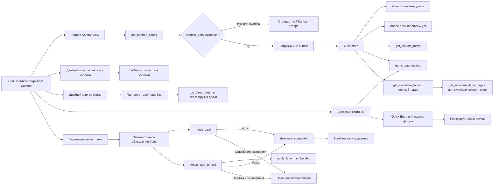

# Dinext Kanban

## 📖 Обзор

Dinext Kanban — приложение для Frappe Framework, которое дополняет стандартное Kanban-представление интерфейсом на Vue 3. Репозиторий называется `dinext_kanban`, а внутреннее имя устанавливаемого Frappe-приложения — `quick_kanban`.

Новый интерфейс включается конфигурацией сайта и может быть доступен всем пользователям либо заданному списку. Если конфигурацию или frontend bundle загрузить не удаётся, приложение возвращается к стандартному Kanban Frappe.

## ✨ Возможности

- Vue-интерфейс для Kanban Board любого DocType, использующего поле типа `Select`.
- Виртуализация карточек и постраничная загрузка по колонкам для больших досок.
- Начальная загрузка до 100 записей и автоматическая дозагрузка по 30 карточек при прокрутке отдельной колонки.
- Создание карточек из колонки (**Add {DocType}** / `+` в заголовке): серверная политика `get_create_options` выбирает Quick Entry, полную форму или блокировку; статус колонки и значения swimlane подставляются заранее.
- Перемещение карточек мышью и через доступное с клавиатуры меню выбора колонки.
- Двухслойная валидация перемещений: фронтенд фильтрует назначения по Workflow-правам и обязательным полям (`reqd`, `mandatory_depends_on`), сервер повторяет проверки при сохранении.
- Подсветка разрешённых колонок при перетаскивании и блокировка запрещённых назначений.
- Выбор Workflow action, когда несколько переходов ведут в одну колонку.
- Оптимистичное обновление с откатом при недостаточных правах, ошибке валидации или конкурентном изменении документа; краткая подсветка успешного перемещения и анимация отката (с учётом `prefers-reduced-motion`).
- После успешного Move/DnD или создания карточки — раскрытие сжатой колонки/дорожки при необходимости и прокрутка к карточке; недавно созданные записи удерживаются сверху колонки до следующего обновления списка.
- Проверка прав чтения и записи на уровне DocType и поля.
- Подсчёт общего количества карточек в каждой колонке с учётом текущих фильтров.
- Двойной клик по счётчику в заголовке колонки открывает ListView с фильтром этой колонки и сохранёнными фильтрами доски.
- Настройка цвета колонок и выделение значений выбранного поля.
- Сжатие колонок по ширине (меню **Сжать** / **Открыть**, двойной клик, auto-expand при задержке курсора во время DnD карточки); состояние хранится локально на доску.
- Изменение ширины колонок перетаскиванием за правый край (для пользователей с правом записи на `Kanban Board`); с зажатым Shift — та же ширина применяется ко всем колонкам; значение сохраняется в `Kanban Board Column.custom_column_width`.
- Скрытие колонок с доски через меню колонки (для пользователей с правом записи на `Kanban Board`); элемент **Добавить колонку** после последней видимой колонки возвращает скрытые колонки и добавляет новые из допустимых значений Select-поля доски.
- Расцветка карточек по полю `color` (fieldtype `Color`) в целевом DocType: цветная полоска слева и лёгкий tint фона.
- Просмотр и изменение назначенных пользователей через стандартный Assign To Dialog.
- Отображение меток (`_user_tags`) на карточке при включённом **Show Tags** / **Показывать теги** на Kanban Board; при праве записи — добавление и удаление через стандартный `frappe.ui.TagEditor`.
- Ряд **Доп. информация** на карточке при включённом **Extra Info** / **Доп. информация** (`custom_show_extra_info`): копирование ссылки на форму, like, комментарии (счётчик → форма), файлы (список, загрузка, preview/`preview_attachment` или открытие файла, удаление с учётом прав).
- Двойной клик по метке добавляет её в текущий фильтр доски (`_user_tags like …`), как клик по тегу в list sidebar.
- Перенос меток между карточками: ЛКМ — копирование, ПКМ — перемещение; сохранение через `add_tag` / `remove_tag`.
- Отображение Link / Dynamic Link по title связанной записи (`hydrateLinkTitles` / `frappe._link_titles`), а не по сырому имени; поля `Percent` — progress bar.
- Inline-редактирование видимых полей карточки (заголовок из `title_field`, поля `Fields`, Highlighted Field): одинарный клик открывает штатный контрол Frappe после `frappe.model.with_doc`; двойной клик по карточке (включая поля и chrome) открывает форму документа; двойной клик по Link — связанную запись; теги, кнопка Move и назначения навигацию не запускают.
- Переход из диалога Kanban Settings к записи текущей Kanban Board.
- Режим **Минимизировать**: компактные карточки (заголовок, drag-handle, highlight, Move, assignees) с раскрытием по hover; плотность при DnD карточек и меток хранится в Vuex (в том числе принудительное схлопывание источника после tag-drag).
- Режим **Swimlane** (**Group By** / **Группировать**): горизонтальные дорожки по **Assigned To** / **Исполнитель**, полю `Select` / `Link` / `User` или `Table MultiSelect`; общий x/y-скролл, sticky-заголовки колонок и дорожек, ленивая подгрузка ячеек, DnD между колонками и дорожками с теми же проверками прав, что и у обычного перемещения.
- Явные состояния загрузки, отсутствия данных и ошибки с повторным запросом.
- Санитизация форматированного содержимого карточек через DOMPurify.
- Обновление через стандартный lifecycle списка Frappe без дополнительной realtime-подписки.
- Безопасный переход на стандартный Kanban при ошибке запуска нового интерфейса.

## 🚀 Установка

Репозиторий называется `dinext_kanban`, но в bench приложение клонируется в каталог **`apps/quick_kanban`**, а Frappe app name — **`quick_kanban`**.

### Установка на новый сайт

Выполняйте шаги **строго в этом порядке** из корня bench (`<bench-root>`):

**1. Загрузить приложение**

```bash
cd <bench-root>

bench get-app quick_kanban \
  https://dinext.gitlab.yandexcloud.net/erpnext/dinext/dinext_kanban.git \
  --branch <branch-name>
```

Параметр `--branch` опционален (если не указан — default branch репозитория). Если каталог `apps/quick_kanban` уже существует и нужно заменить исходники, используйте `--overwrite` или вручную переключите remote и checkout нужной ветки в `apps/quick_kanban`.

**2. Установить frontend-зависимости**

```bash
cd apps/quick_kanban
yarn install --frozen-lockfile
```

**3. Установить приложение на сайт**

```bash
cd <bench-root>
bench --site <site-name> install-app quick_kanban
```

**4. Собрать frontend**

Frappe Desk отдаёт **хешированные** bundles из `quick_kanban/public/dist/` через `sites/assets/assets.json`. Одной сборки Vite недостаточно: нужны copy в `public/` и `bench build`.

Команда workspace уже выполняет полный цикл (`vite build` → copy в `quick_kanban/public/` → `bench build --app quick_kanban`):

```bash
cd apps/quick_kanban
yarn workspace quick_kanban build
```

Отдельный `bench build --app quick_kanban` нужен только если собирали Vite/copy без этого скрипта. Альтернатива шагу `bench build` — Frappe esbuild напрямую:

```bash
cd apps/frappe && yarn run production --apps quick_kanban
```

**5. Применить изменения на сайте**

```bash
cd <bench-root>
bench --site <site-name> migrate
bench --site <site-name> clear-cache
bench restart
```

`migrate` подтягивает переводы из `quick_kanban/translations/`. `bench restart` нужен на production/staging bench с supervisor.

**6. Включить новый Kanban**

Без этого шага используется стандартный Kanban Frappe:

```bash
bench --site <site-name> set-config kanban_beta 1
bench --site <site-name> clear-cache
```

Для поэтапного включения см. раздел [Конфигурация](#-конфигурация).

**7. Проверка в браузере**

Откройте Kanban Board и выполните жёсткое обновление страницы (`Ctrl+Shift+R`), чтобы подтянуть новый bundle.

#### Краткий чеклист (новый сайт)

```bash
# 1–3: загрузка и install-app
bench get-app quick_kanban https://dinext.gitlab.yandexcloud.net/erpnext/dinext/dinext_kanban.git --branch <branch-name>
cd apps/quick_kanban && yarn install --frozen-lockfile && cd ../..
bench --site <site-name> install-app quick_kanban

# 4–5: сборка assets (vite + copy + bench build) и применение
cd apps/quick_kanban && yarn workspace quick_kanban build && cd ../..
bench --site <site-name> migrate
bench --site <site-name> clear-cache
bench restart

# 6: feature flag
bench --site <site-name> set-config kanban_beta 1
bench --site <site-name> clear-cache
```

### Обновление на существующем сайте

Если `quick_kanban` уже установлен, **`install-app` повторно не нужен** (пока нет новых DocType/patches). Достаточно обновить исходники, пересобрать assets и применить на сайте:

```bash
cd apps/quick_kanban
git fetch && git checkout <branch-name> && git pull

yarn install --frozen-lockfile
yarn workspace quick_kanban build

cd <bench-root>
bench --site <site-name> migrate
bench --site <site-name> clear-cache
bench restart
```

`yarn workspace quick_kanban build` уже включает `bench build --app quick_kanban`. `bench restart` **не заменяет** сборку assets — без неё Desk продолжит отдавать старые hashed bundles.

### Если `bench` падает с `ImportError: _check_nested_chain`

Конфликт версий `frappe-bench` и `click`. Обновите bench CLI:

```bash
pip3 install --user --upgrade 'frappe-bench>=5.31'
```

Пока `bench` недоступен, можно использовать обходные команды из корня bench:

```bash
# Очистка кэша сайта
env/bin/python -c "
import os, sys
sys.path.insert(0, 'apps/frappe')
os.chdir('sites')
import frappe
frappe.init(site='<site-name>', sites_path='.')
frappe.connect()
frappe.clear_cache()
print('cache cleared')
"

# Сборка assets без CLI bench (vite + copy, затем Frappe esbuild)
cd apps/quick_kanban && yarn vite build && yarn copy-js
cd ../frappe && yarn run production --apps quick_kanban
```

## 🛠️ Использование

1. Создайте или откройте стандартный `Kanban Board` в Frappe.
2. Выберите целевой DocType и поле типа `Select`, значения которого станут колонками.
3. Добавьте поля, которые должны отображаться на карточке.
4. При необходимости задайте `Highlighted Field` и таблицу цветов для его значений.
5. Для расцветки карточек добавьте в целевой DocType поле **`color`** с типом **`Color`** и заполните его у записей (hex, например `#FF5733`). Поле подтягивается автоматически и не отображается в теле карточки.
6. Чтобы показывать метки на карточках, включите **Show Tags** / **Показывать теги** на форме Kanban Board (после `show_labels`).
7. Чтобы показывать ряд ссылка / like / комментарии / файлы, включите **Extra Info** / **Доп. информация** на форме Kanban Board.
8. Чтобы сгруппировать карточки по дорожкам (swimlane), задайте **Swimlane Field** / **Поле swimlane** на форме Kanban Board или выберите группировку в выпадающем списке **Group By** / **Группировать** на панели инструментов Kanban (при праве записи на `Kanban Board`).
9. Откройте Kanban-представление списка.

Двойной клик по badge с количеством записей в заголовке колонки открывает ListView того же DocType с фильтром по значению колонки (например, `status = Open`) и текущими фильтрами доски из filter bar. Одиночный клик по счётчику ничего не делает.

Одинарный клик по значению поля на карточке (заголовок, поля из `Fields`, Highlighted Field) загружает полный документ через `frappe.model.with_doc`, проверяет права/workflow и при возможности редактирования открывает штатный UI-контрол Frappe того же визуального размера, что и read-отображение. Сохранение выполняется через `frappe.db.set_value` (полный `doc.save()` на сервере). Для редактируемых Link одинарный клик не ведёт в форму (ссылка нейтрализуется). Двойной клик по поверхности карточки (поля, highlight, chrome) открывает форму документа карточки; двойной клик по Link — форму связанной записи; теги, кнопка Move и назначения форму карточки не открывают.

Для полей `Link` / `Dynamic Link` на карточке подтягиваются title-подписи связанных записей (`hydrateLinkTitles`). Поля `Percent` отображаются progress bar (значение clamp 0–100), а не сырым числом.

Карточку можно переместить drag-and-drop или через действие `Move to`. Перед перемещением клиент запрашивает `quick_kanban.api.get_move_options` и локально проверяет обязательные поля (`reqd`, `mandatory_depends_on`) для preview целевого состояния. Запрещённые назначения не показываются в меню и не принимают drop. При нескольких Workflow actions для одной колонки открывается диалог выбора action.

На **обычной** доске (без swimlane) сохранение выполняется через `quick_kanban.api.move_card` с `board_name`, именем документа, целевой колонкой, `expected_modified` и опциональным `workflow_action`. Сервер повторяет проверки Workflow-прав и mandatory rules, затем либо применяет `apply_workflow`, либо вызывает полный `doc.save()` с lifecycle hooks целевого DocType.

После успешного перемещения сжатая колонка (и при необходимости дорожка) раскрывается, список прокручивается к карточке, краткая подсветка подтверждает успех; при ошибке позиция откатывается с анимацией. Поведение анимаций учитывает `prefers-reduced-motion`.

### Создание карточек

В заголовке колонки (иконка `+`) и в футере (**Add {DocType}**) доступно создание записи в целевой колонке, если политика создания это разрешает.

При загрузке доски клиент запрашивает `quick_kanban.api.get_create_options` (политика в `quick_kanban.move_policy`). Для каждой колонки сервер возвращает:

| `form_mode` | Поведение |
|-------------|-----------|
| `quick_entry` | `frappe.ui.form.make_quick_entry` с prefill статуса колонки |
| `full_form` | полная форма нового документа (`route_options` + `frappe.model.get_new_doc`) |
| `blocked` | кнопка скрыта или действие блокируется с сообщением (нет `create`, Workflow, невалидная колонка) |

Режим выбирается по правилам Frappe Quick Entry (флаг DocType, число обязательных полей, отсутствие обязательных Table) и списку недостающих mandatory для preview документа в целевой колонке.

В режиме **Swimlane** при создании дополнительно подставляются значения дорожки (`swimlaneCreate.buildSwimlaneCreateDefaults`): поле `Select` / `Link` / `User`, child-строки `Table MultiSelect`, либо после сохранения — `assign_to.add` для дорожки **Assigned To**.

После успешного сохранения карточка появляется в колонке (или ячейке swimlane), **удерживается сверху** списка недавно созданных и прокручивается в зону видимости (scroll-reveal).

### Swimlane (Group By)

Swimlane разбивает доску на горизонтальные дорожки (строки) при сохранении тех же статусных колонок. Настройка хранится в Custom Field `Kanban Board.custom_swimlane_field` (**Swimlane Field** / **Поле swimlane**).

#### Включение

- На форме `Kanban Board` выберите значение Autocomplete **Swimlane Field**, либо
- в панели инструментов Desk (рядом с **Минимизировать**, при праве **write** на `Kanban Board`) откройте **Group By** / **Группировать** и выберите поле или **No Grouping** / **Без группировки**.

Сохранение идёт через `quick_kanban.api.set_swimlane_field`; список допустимых полей — `quick_kanban.api.get_swimlane_field_options`.

#### Режимы группировки

| Значение `custom_swimlane_field` | Режим | Дорожки |
|----------------------------------|-------|---------|
| пусто | `off` | обычная доска без swimlane |
| `__assign` (**Assigned To** / **Исполнитель**) | `assign` | по **Open** ToDo-назначениям (как `_assign`; Closed/Cancelled и DocShare не участвуют) + дорожка **Unassigned** / **Без назначения** |
| поле `Select`, `Link` или `User` | `field` | по значениям поля (+ **Unassigned** / **Без назначения** для пустых) |
| поле `Table MultiSelect` | `multi` | по значениям child Link; карточка с несколькими значениями может отображаться в нескольких дорожках (+ **Unassigned** / **Без назначения**) |

Для `Select` дорожки строятся по options поля (с учётом переводов DocType). Для `Link` / `User` / assign / multi — по фактически встречающимся значениям среди записей, попадающих под текущие фильтры доски; подписи Link используют title field связанного DocType, User — полное имя.

#### Макет и навигация

- Один общий скроллер по горизонтали и вертикали (`kanban--swimlanes`); колонки выровнены по сетке во всех дорожках.
- Sticky-ряд заголовков колонок сверху и sticky-chrome каждой дорожки (название, счётчик, для assign — аватар).
- Дорожки сворачиваются/разворачиваются кликом по chrome; раскрытые ключи хранятся в `localStorage` (`quick_kanban:expanded_lanes:{board_name}`).
- При перетаскивании карточки над свёрнутой дорожкой она автоматически раскрывается после задержки (~400 ms), аналогично auto-expand сжатых колонок.
- Дорожки с карточками (по счётчикам ячеек) поднимаются выше пустых (`sortLanesByOccupancy`).
- Сжатие, ресайз и скрытие колонок работают и в swimlane: сжатая колонка занимает узкий трек во всех дорожках; **Добавить колонку** остаётся в sticky-заголовке.

#### Загрузка данных

В отличие от классической доски, swimlane не грузит все колонки целиком:

1. `get_swimlane_lanes` — список дорожек;
2. `get_cell_totals` — счётчики `{lane → {column → count}}` с учётом фильтров;
3. карточки ячеек подгружаются лениво (`get_swimlane_lane_page` / `get_swimlane_column_page`) при раскрытии и видимости дорожки, с дозагрузкой при прокрутке ячейки.

Высоты ячеек в строке выравниваются (stick-room / `padding-bottom` на корне Sortable), чтобы пустая область соседней колонки после кнопки **Добавить** оставалась drop-target при разном числе карточек.

#### Перемещение карточек

Drag-and-drop и меню **Move to** работают между колонками и/или дорожками. Сохранение при смене колонки и/или дорожки — `quick_kanban.api.move_card_to_cell` с `to_column`, опциональными `from_lane` / `to_lane`, `expected_modified` и `workflow_action` (не `move_card`):

- **колонка** — как обычно: Workflow / `doc.save()`, обязательные поля, optimistic update и откат;
- **дорожка `field`** — запись значения swimlane-поля (пустое → Unassigned);
- **дорожка `assign`** — Assign To / снятие назначения через Desk API (`assign_to.add` / `remove`); перенос в Unassigned снимает всех assignees;
- **дорожка `multi`** — обновление child-строк Table MultiSelect (добавление целевого значения, снятие исходного при смене дорожки; Unassigned очищает поле).

Смена дорожки запрещена, если нет `write` на DocType, swimlane-поле read-only / без права на поле, или Workflow state не разрешает правку. Фронтенд заранее скрывает запрещённые цели и показывает overlay на ячейках, куда drop недоступен. После успеха — тот же scroll-reveal и подсветка, что и на обычной доске.

### Режим «Минимизировать»

В панели инструментов Desk (слева от кнопки **Фильтр**) доступен чекбокс **Минимизировать**. Состояние запоминается отдельно для каждой Kanban Board (`localStorage`).

Когда режим включён:

- карточки показываются компактно: видны заголовок со ссылкой, drag-handle, highlight-pill, кнопка Move и assignees; поля из `Fields` доски и метки скрыты;
- при наведении мыши карточка с небольшой задержкой раскрывается (поля появляются с анимацией), после ухода курсора снова сжимается;
- если карточку перетаскивают в раскрытом виде, в целевой колонке она остаётся раскрытой и схлопывается только после ухода курсора;
- при перетаскивании метки карточка под курсором раскрывается с той же задержкой; после drop **источник принудительно схлопывается** (состояние в Vuex, переживает remount виртуального списка), а **успешная цель** остаётся раскрытой через density-hold, пока курсор над ней или до обычного collapse;
- повторный hover, inline-edit, активный ввод метки (как inline-edit через `activeInlineEdit`) или новый tag-drag с карточки снова разрешают раскрытие и удерживают карточку раскрытой до окончания редактирования;
- цветовой акцент карточки (`color`) сохраняется и в компактном, и в раскрытом виде.

Чекбокс добавляет `kanban_view.bundle.js` в page-actions Frappe; плотность реализована в Vuex (`densityHoldExpandedCard`, `densityForceCollapsedCards`) и в `KanbanCard` / `tagDragDrop`.

### Сжатие колонок

В меню колонки (иконка «⋯») доступны пункты **Сжать** / **Открыть** (локальное UI-состояние, не путать со **Скрыть**).

Когда колонка сжата:

- ширина сужается с анимацией; карточки и кнопка «+» скрыты;
- в заголовке остаются плашка количества и меню; название показывается вертикально;
- колонку по-прежнему можно переупорядочить перетаскиванием за заголовок;
- двойной клик по chrome колонки переключает сжатие; двойной клик по счётчику в открытой колонке по-прежнему открывает ListView, в сжатой — только раскрывает колонку;
- при перетаскивании карточки на сжатую колонку она автоматически раскрывается, если курсор **задержался** над ней (~400 ms); при сквозном проезде без задержки колонка остаётся сжатой;
- список карточек остаётся drop-target, чтобы принять карточку после раскрытия.

Состояние сжатых колонок запоминается в `localStorage` отдельно для каждой Kanban Board (`quick_kanban:collapsed_columns:{board_name}`).

### Ширина колонок

При праве **write** на документ `Kanban Board` у правого края развёрнутой колонки доступен resize-handle:

- перетаскивание меняет ширину текущей колонки;
- с зажатым **Shift** (в том числе на Mac) все видимые колонки доски получают ту же абсолютную ширину в пикселях;
- во время drag ширина ограничивается диапазоном **15–50%** ширины окна (`window.innerWidth`); после сохранения ограничение больше не применяется (в том числе при изменении размера окна или повторном открытии доски);
- значение сохраняется на уровне child-строки `Kanban Board Column` в Custom Field `custom_column_width` (Int, px, по умолчанию `250`) через `quick_kanban.api.set_column_widths`;
- переупорядочивание колонок не сбрасывает ширину: `update_column_order` переопределён в `quick_kanban`, чтобы копировать `custom_column_width` при пересборке child-строк;
- у сжатой колонки визуально остаётся `52px`; сохранённая ширина не меняется и снова применяется после раскрытия.

**Сжать ≠ изменить ширину:** сжатие — локальный UI-режим; ресайз за край — серверная настройка ширины колонки на доске.

### Скрытие колонок

В меню колонки (иконка «⋯» в заголовке) рядом с выбором цвета и сжатием доступен пункт **Скрыть**, если у пользователя есть право **write** на документ `Kanban Board`.

- на доске показываются только колонки со статусом `Active` (стандартное поле `Kanban Board Column.status`);
- «Скрыть» сохраняет колонку как `Archived` через штатный API Frappe `archive_restore_column` и сразу убирает её из видимого перечня;
- если есть скрытые колонки или значения Select-поля доски, ещё не представленные среди Active-колонок, после последней видимой колонки появляется компактный элемент **Добавить колонку** с выпадающим списком;
- выбор скрытой колонки восстанавливает её (`archive_restore_column`, `status: Active`) и подгружает карточки;
- выбор значения, которого ещё нет на доске, добавляет колонку через штатный API Frappe `add_column` и подгружает карточки;
- альтернативно колонку можно вернуть через форму записи Kanban Board (из диалога Kanban Settings — кнопка **Open Kanban Board** / **Открыть Kanban-доску**): в child-таблице колонок смените Status на `Active`, сохраните и обновите Kanban-представление.

**Сжать ≠ Скрыть ≠ ширина:** сжатие только сужает колонку в UI и хранится локально; ресайз сохраняет ширину на `Kanban Board Column`; скрытие архивирует колонку на сервере и убирает её с доски.

### Метки на карточках

На форме `Kanban Board` чекбокс **Show Tags** / **Показывать теги** (`custom_show_tags`) включает блок меток на карточке. Данные берутся из стандартного поля `_user_tags`.

### Доп. информация на карточках

На форме `Kanban Board` чекбокс **Extra Info** / **Доп. информация** (`custom_show_extra_info`, по умолчанию выключен) показывает после блока меток правый ряд иконок:

- **ссылка** — копирует полный URL формы документа в буфер (`frappe.utils.copy_to_clipboard`);
- **like** — переключает like/not-like для текущего пользователя (`frappe.desk.like.toggle_like`);
- **комментарии** — счётчик `_comment_count`; клик открывает форму документа;
- **файлы** — счётчик вложений (`quick_kanban.api.get_attachment_counts`); меню со списком, **+ Загрузить**, preview через `preview_attachment` при наличии приложения иначе открытие файла, удаление через `remove_attach` с правилами Form (`write` / `protect_attached_files`).

В режиме **Минимизировать** ряд скрывается вместе с полями и метками.

Когда метки включены:

- **без права write** на DocType доски — только просмотр (до трёх цветных pill, как `ListView.get_tags_html`);
- **с правом write** — интерактивный редактор на базе `frappe.ui.TagEditor` / `frappe.ui.Tags`: удаление через крестик на pill, добавление через иконку `#es-line-tag` с выпадающим списком существующих меток (`get_tags`); сохранение через `frappe.desk.doctype.tag.tag.add_tag` / `remove_tag`;
- **двойной клик** по pill ставит фильтр доски `_user_tags like <метка>` через `cur_list.filter_area` (предыдущий фильтр по `_user_tags` заменяется; остальные фильтры filter bar сохраняются), после чего список/канбан обновляются штатным refresh;
- **перетаскивание** метки на другую карточку: левая кнопка мыши — копирование на целевую карточку, правая — перемещение (снятие с исходной и добавление на целевую); drop на ту же карточку или карточку, где метка уже есть, игнорируется;
- в режиме **Минимизировать** после завершения активного tag-drag (copy, move, cancel, forbidden) источник помечается в store как force-collapsed и сразу отображается компактно; после успешного drop цель получает density-hold и раскрывается, чтобы показать обновлённые метки;
- активное добавление метки (кнопка add / ввод) участвует в том же lifecycle, что и inline-edit (`activeInlineEdit` / `_user_tags`): карточка не схлопывается, клик вне карточки завершает ввод.

Редактирование и перенос меток доступны только при `frappe.model.can_write` на DocType; окончательная проверка прав выполняется серверными API тегов.

### Расцветка карточек по полю `color`

Quick Kanban автоматически использует поле **`color`** с fieldtype **`Color`** в DocType, для которого создана доска:

- значение hex из Frappe Color применяется как **цветная полоска слева** (4px) и **лёгкий tint фона** (10%);
- поле добавляется в запрос данных доски автоматически, даже если не указано в `Fields` Kanban Board;
- hex не показывается среди полей карточки;
- пустое или невалидное значение — обычная карточка без расцветки.

Требования:

- fieldname строго **`color`**, fieldtype строго **`Color`** (поле с другим именем или типом не используется);
- у записей должно быть заполнено значение цвета;
- после изменений frontend выполните сборку (`yarn workspace quick_kanban build`, `clear-cache`) и обновите страницу Kanban (`Ctrl+Shift+R`).

## 📦 Технологии

- Frappe Framework 15 и Python — серверные методы, права и подключение assets.
- Vue 3 — компоненты доски.
- Vuex 4 — состояние, загрузка данных и оптимистичные операции.
- Vite — сборка frontend bundle.
- `vue-virtual-draglist` — виртуализация списков карточек и DnD карточек.
- SortableJS — переупорядочивание колонок и drop-зоны ячеек (в том числе в swimlane).
- DOMPurify — очистка форматированного HTML.
- Vitest и Vue Test Utils — модульные и компонентные тесты.
- Playwright — browser-тесты пользовательских сценариев.
- ESLint и Frappe Semgrep rules — статические проверки.

## 🔧 Конфигурация

Включите новый Kanban для всех пользователей сайта:

```bash
bench --site <site-name> set-config kanban_beta 1
```

Для поэтапного включения задайте список пользователей в `sites/<site-name>/site_config.json`:

```json
{
  "kanban_beta": 1,
  "kanban_beta_users": [
    "user@example.com",
    "manager@example.com"
  ]
}
```

Правила применения конфигурации:

- `kanban_beta = 0` или отсутствие параметра — используется стандартный Kanban Frappe;
- `kanban_beta = 1` и пустой `kanban_beta_users` — новый Kanban доступен всем;
- `kanban_beta = 1` и непустой `kanban_beta_users` — новый Kanban доступен только перечисленным пользователям.

## ✅ Требования

- Frappe Framework 15.
- Python 3.10 или новее.
- Node.js 24 и Yarn для сборки и frontend-проверок.
- Рабочий bench с Redis и MariaDB, настроенными согласно требованиям Frappe.
- Chromium для запуска browser-тестов Playwright.

## 🤝 Участие в разработке

1. Ознакомьтесь с [AGENTS.md](AGENTS.md) и центральными правилами Dinext.
2. Создавайте изменения в отдельной ветке от актуальной целевой ветки.
3. Добавляйте тесты для нового поведения и исправленных регрессий.
4. Перед review запускайте lint, unit-тесты, browser-тесты, backend-тесты и сборку.
5. Не включайте в commit временные файлы, отчёты покрытия, Playwright artifacts и `node_modules`.

Pull request автоматически проверяется frontend/backend workflow и Frappe Semgrep rules.

## Разработка и проверки

Установите frontend-зависимости из корня приложения:

```bash
yarn install --frozen-lockfile
```

Запустите frontend-проверки:

```bash
yarn workspace quick_kanban lint
yarn workspace quick_kanban test:run
yarn workspace quick_kanban test:browser
yarn workspace quick_kanban build
python3 -m compileall -q quick_kanban
```

Backend-тесты выполняются из корня bench:

```bash
bench --site <site-name> run-tests --app quick_kanban
```

Для локальной разработки frontend:

```bash
yarn dev
```

Frontend состоит из двух слоёв: `quick_kanban/public/js/kanban_view.bundle.js` расширяет стандартный `KanbanView` (в том числе добавляет служебные поля вроде `color` в запрос `reportview.get`, чекбокс **Минимизировать** и dropdown **Group By** в page-actions), а Vite собирает Vue-приложение из `Quick-Kanban/src/`. Команда `yarn workspace quick_kanban build` копирует JavaScript и CSS в `quick_kanban/public/` и сразу запускает `bench build --app quick_kanban`, который собирает хешированные bundles в `quick_kanban/public/dist/` (отдаются через `sites/assets/assets.json`). Перед review и деплоем выполняйте эту команду и проверяйте, что изменения попали в `dist/`.

## Локализация

Все пользовательские строки приложения оборачиваются в `_()` (Python) или `__()` (JavaScript) и сопровождаются русскими переводами в [`quick_kanban/translations/ru.csv`](quick_kanban/translations/ru.csv).

При добавлении новых строк:

1. Оберните текст в `_()` / `__()`.
2. Добавьте пару `"English","Русский",""` в `ru.csv`.
3. После изменения переводов выполните на сайте:

```bash
bench --site <site-name> migrate
bench --site <site-name> clear-cache
```

При необходимости синхронизируйте переводы через `bench update-translations` согласно процессу вашего bench.

## 📄 Документация

- [AGENTS.md](AGENTS.md) — navigation stub к общим инструкциям, skills и rules Dinext.
- [`../dinext-docs/catalog.md`](../dinext-docs/catalog.md) — центральный каталог пользовательской документации.
- [`../dinext-docs/docs/бизнес-функции/задачи/Задачи.md`](../dinext-docs/docs/бизнес-функции/задачи/Задачи.md) — пользовательская документация по задачам и Kanban.
- [`quick_kanban/api.py`](quick_kanban/api.py) — серверные методы: `get_column_totals`, `get_attachment_counts`, `get_move_options`, `get_create_options`, `move_card` (только колонка), `move_card_to_cell` (колонка и/или дорожка), swimlane (`get_swimlane_lanes`, `get_cell_totals`, `get_swimlane_*_page`, `set_swimlane_field`, `get_swimlane_field_options`), ширина колонок (`set_column_widths`, override `update_column_order`).
- [`quick_kanban/move_policy.py`](quick_kanban/move_policy.py) — политики перемещения и создания (`get_move_options`, `get_create_options`, Workflow vs field update).
- [`quick_kanban/swimlane.py`](quick_kanban/swimlane.py) — режимы группировки, построение дорожек, постраничная загрузка ячеек и изменение membership при DnD.
- [`quick_kanban/get_beta_users.py`](quick_kanban/get_beta_users.py) — `get_kanban_config` (feature flags `kanban_beta` / `kanban_beta_users`).
- [`Quick-Kanban/src/`](Quick-Kanban/src/) — исходный код Vue-интерфейса (`SwimlaneRow` / `SwimlaneGroup` / `SwimlaneColumn`, `swimlaneBoard`, `createValidation`, `swimlaneCreate`, `CardTags`, `CardExtraInfo`, `listNavigation.applyUserTagFilter`, `tagDragDrop`, density state и resize колонок в Vuex).
- [`quick_kanban/quick_kanban/custom/kanban_board.json`](quick_kanban/quick_kanban/custom/kanban_board.json) — Custom Fields **Show Tags**, **Extra Info** и **Swimlane Field** на Kanban Board.
- [`quick_kanban/quick_kanban/custom/kanban_board_column.json`](quick_kanban/quick_kanban/custom/kanban_board_column.json) — Custom Field **Column Width** (`custom_column_width`) на Kanban Board Column.

После каждого commit локальный `post-commit` hook формирует предложение для документации в `../dinext-docs/doc-proposals/inbox/`. Повторная установка hook:

```bash
python3 ../dinext-docs/scripts/install_doc_intake_hooks.py \
  --docs-root ../dinext-docs \
  --app-root . \
  --apply
```

## ❤️ Благодарности

Приложение основано на открытом проекте [tridz-dev/quick_kanban](https://github.com/tridz-dev/quick_kanban). Развитие и интеграция в продукт Dinext ведутся в репозитории `dinext_kanban`.

## 🗂️ Структура репозитория

```text
dinext_kanban/
├── .github/workflows/          # CI: quality gates, Semgrep и release workflow
├── Quick-Kanban/
│   ├── e2e/                    # Playwright-сценарии и автономная browser fixture
│   ├── src/
│   │   ├── components/         # Vue-компоненты доски, колонок, карточек, меток и swimlane
│   │   ├── test/               # Общая настройка Vitest и тесты интеграционных scripts
│   │   ├── utils/              # Store, createValidation, swimlaneCreate, DnD меток, swimlaneBoard, меню
│   │   ├── App.vue             # Корневой Vue-компонент
│   │   ├── main.js             # Mount/unmount Vue-приложения
│   │   └── style.css           # Стили нового Kanban
│   ├── package.json            # Frontend-зависимости и команды (build = vite + copy + bench build)
│   ├── playwright.config.js    # Конфигурация browser-тестов
│   └── vite.config.js          # Сборка и unit-тесты
├── quick_kanban/
│   ├── public/
│   │   ├── css/                # Собранные и подключаемые стили
│   │   └── js/                 # Bootstrap, KanbanView override и Vue bundle
│   ├── quick_kanban/custom/    # Custom Fields: Show Tags / Extra Info / Swimlane Field (Board), Column Width (Column)
│   ├── tests/                  # Backend-тесты Frappe
│   ├── translations/           # CSV-переводы (ru)
│   ├── api.py                  # Permission-aware API доски
│   ├── move_policy.py          # Политики move / create и Workflow
│   ├── validation.py           # Mandatory rules при перемещении
│   ├── swimlane.py             # Группировка по дорожкам и lane membership
│   ├── get_beta_users.py       # Чтение feature flags из site config
│   └── hooks.py                # Метаданные Frappe и подключение assets
├── AGENTS.md                   # Указатель на central dinext-docs
├── package.json                # Корневой Yarn workspace
├── pyproject.toml              # Python package metadata
├── yarn.lock                   # Зафиксированные frontend-зависимости
└── license.txt                 # Лицензия MIT
```

## 🔗 Поток данных



## Лицензия

Проект распространяется по лицензии MIT. Полный текст находится в [license.txt](license.txt).
