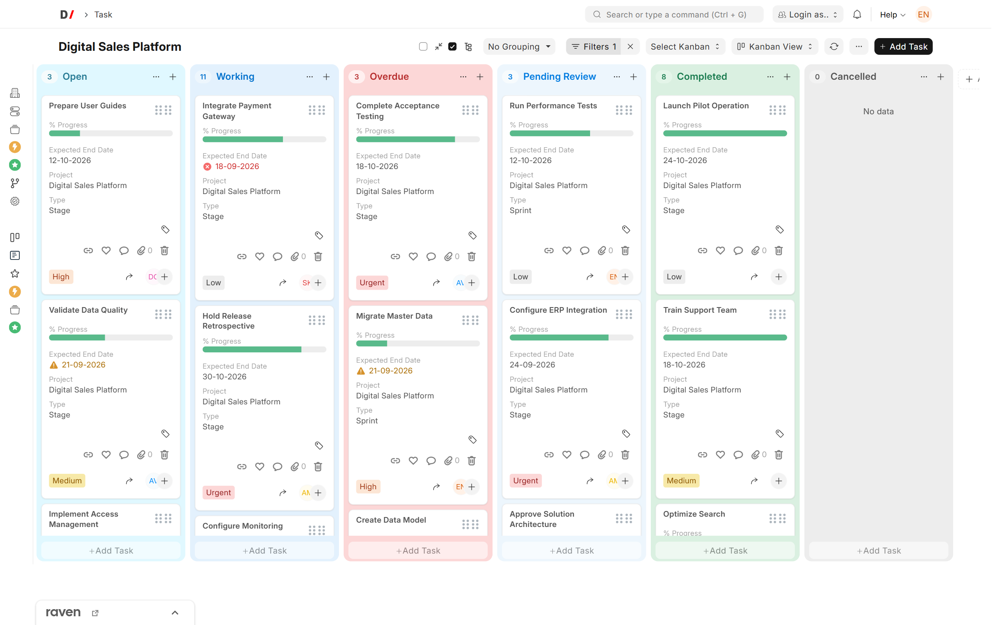
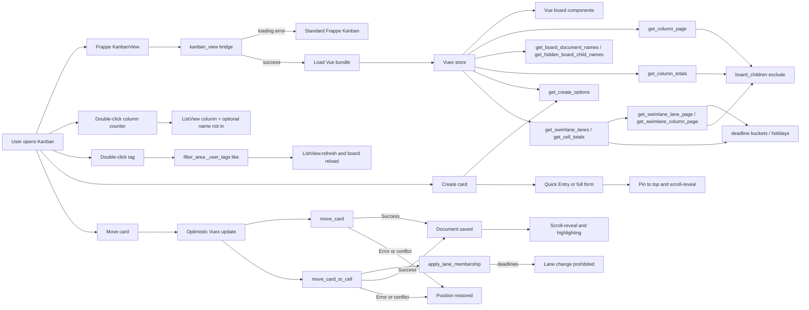

[Русский](README.ru.md)

<!-- dinext-presentation:start -->
<p align="center">
  <a href="https://dinext.ru"></a>
</p>
<h1 align="center">Dinext Kanban</h1>

<hr>

<p align="center">Configurable Kanban boards for Dinext with workflow-aware moves, filtering and task cards.</p>

<p align="center">
  
</p>
<p align="center"><sub>A demonstration project board organized by task status.</sub></p>

<p align="center">
  <a href="https://dinext.ru">Website</a> · <a href="https://docs.dinext.ru">Documentation</a>
</p>
<!-- dinext-presentation:end -->

# Dinext Kanban

## 📖 Overview

An independent Dinext project developed and maintained by Dinext. The canonical repository is [Dinext-pro/dinext_kanban](https://github.com/Dinext-pro/dinext_kanban). Automatic synchronization with the original project is not used.

The application was originally based on [quick_kanban](https://github.com/tridz-dev/quick_kanban). Original authorship information and the license are preserved.

Dinext Kanban is an application for Frappe Framework that adds a Vue 3 interface to the standard Kanban view. The repository is named `dinext_kanban`, and the internal name of the installable Frappe application is `dinext_kanban`.

The new interface is enabled through site configuration and can be available to all users or a specified list. If the configuration or frontend bundle cannot be loaded, the application falls back to standard Frappe Kanban.

## ✨ Features

- A Vue interface for the Kanban Board of any DocType that uses a `Select` field.
- Card virtualization and per-column pagination for large boards.
- Initial loading of up to 100 records, with 30 more cards loaded automatically when scrolling an individual column.
- Card creation from a column (**Add {DocType}** / `+` in the header): the server-side `get_create_options` policy selects Quick Entry, a full form, or blocking; column status and swimlane values are prefilled.
- Card movement using the mouse or a keyboard-accessible column selection menu.
- Two-layer move validation: the frontend filters destinations by Workflow permissions and mandatory fields (`reqd`, `mandatory_depends_on`), and the server repeats these checks when saving.
- Highlights allowed columns during drag-and-drop and blocks prohibited destinations.
- Workflow action selection when several transitions lead to the same column.
- Optimistic updates with rollback on insufficient permissions, validation errors, or concurrent document changes; a brief highlight after a successful move and a rollback animation (respecting `prefers-reduced-motion`).
- After a successful Move/DnD or card creation, expands a collapsed column/lane if needed and scrolls to the card; newly created records stay at the top of the column until the next list refresh.
- Read and write permission checks at both DocType and field levels.
- Total card counts per column, accounting for current filters (and the child-task hiding mode described below).
- Double-clicking the column header counter opens ListView with the column filter and preserved board filters; when children are hidden, adds `name not in` (with a threshold for large boards).
- **Show child tasks** checkbox for tree DocTypes (such as Task with `parent_task`): hides cards whose direct parent is also on the board by default; state is stored in `localStorage` per board.
- **Child panel** / child data area: a child-count badge on the card opens a nested mini-board beneath the parent (supports nesting and closing by clicking the host or dimmed cards at the same level).
- Column color configuration and highlighting of values from a selected field.
- Column width collapsing (**Collapse** / **Expand** menu, double-click, auto-expand after hovering during card DnD); state is stored locally per board.
- Column resizing by dragging the right edge (for users with write permission on `Kanban Board`); holding Shift applies the same width to all columns; the value is saved in `Kanban Board Column.custom_column_width`.
- Hiding columns through the column menu (for users with write permission on `Kanban Board`); the **Add column** item after the last visible column restores hidden columns and adds new ones from the board's allowed Select values.
- Card coloring through a `color` field (fieldtype `Color`) in the target DocType: a colored strip on the left and a light background tint.
- Viewing and changing assignees through the standard Assign To Dialog.
- Tags (`_user_tags`) on cards when **Show Tags** is enabled on the Kanban Board; users with write permission can add and remove them through the standard `frappe.ui.TagEditor`.
- An **Extra Info** row on cards when **Extra Info** (`custom_show_extra_info`) is enabled: copy form link, like, comments (counter → form), and files (list, upload, preview/`preview_attachment` or opening the file, permission-aware deletion).
- Double-clicking a tag adds it to the current board filter (`_user_tags like …`), like clicking a tag in the list sidebar.
- Dragging tags between cards: left mouse button to copy, right mouse button to move; saved through `add_tag` / `remove_tag`.
- Link / Dynamic Link values displayed using the linked record's title (`hydrateLinkTitles` / `frappe._link_titles`) rather than its raw name; `Percent` fields use a progress bar.
- Inline editing of visible card fields (the title from `title_field`, `Fields`, Highlighted Field): a single click opens the standard Frappe control after `frappe.model.with_doc`; double-clicking the card (including fields and chrome) opens the document form; double-clicking a Link opens the linked record; tags, the Move button, and assignments do not trigger navigation.
- Navigation from the Kanban Settings dialog to the current Kanban Board record.
- **Minimize** mode: compact cards (title, drag handle, highlight, Move, assignees) that expand on hover; density during card and tag DnD is stored in Vuex (including forced source collapse after tag dragging).
- **Swimlane** mode (**Group By**): horizontal lanes by **Assigned To**, a `Select` / `Link` / `User` field or `Table MultiSelect`, or **Deadlines**; shared x/y scrolling, sticky column and lane headers, lazy cell loading, and DnD between columns and lanes with the same permission checks as regular moves (switching **Deadlines** lanes is prohibited).
- **Deadline Tracking** on Kanban Board: a Date/Datetime field, an attention window in working days, and a list of columns to track; card date highlighting (overdue / approaching) and **Group By → Deadlines** grouping.
- Explicit loading, empty, and error states with retry.
- Formatted card content sanitized with DOMPurify.
- Refresh through the standard Frappe list lifecycle without an additional realtime subscription.
- Safe fallback to standard Kanban if the new interface fails to start.

## 🚀 Installation

The repository is named `dinext_kanban`, but bench clones the application into **`apps/dinext_kanban`**, and its Frappe app name is **`dinext_kanban`**.

### Installing on a new site

Run these steps **strictly in this order** from the bench root (`<bench-root>`):

**1. Download the application**

```bash
cd <bench-root>

bench get-app dinext_kanban \
  https://github.com/Dinext-pro/dinext_kanban.git \
  --branch <branch-name>
```

The `--branch` parameter is optional (if omitted, the repository's default branch is used). If `apps/dinext_kanban` already exists and you need to replace its source, use `--overwrite` or manually change the remote and check out the required branch in `apps/dinext_kanban`.

**2. Install frontend dependencies**

```bash
cd apps/dinext_kanban
yarn install --frozen-lockfile
```

**3. Install the application on the site**

```bash
cd <bench-root>
bench --site <site-name> install-app dinext_kanban
```

**4. Build the frontend**

Frappe Desk serves **hashed** bundles from `dinext_kanban/public/dist/` through `sites/assets/assets.json`. Vite build alone is insufficient: copying to `public/` and running `bench build` are required.

The workspace command already performs the full cycle (`vite build` → copy to `dinext_kanban/public/` → `bench build --app dinext_kanban`):

```bash
cd apps/dinext_kanban
yarn workspace dinext_kanban build
```

A separate `bench build --app dinext_kanban` is required only if you ran Vite/copy without this script. An alternative to the `bench build` step is invoking Frappe esbuild directly:

```bash
cd apps/frappe && yarn run production --apps dinext_kanban
```

**5. Apply site changes**

```bash
cd <bench-root>
bench --site <site-name> migrate
bench --site <site-name> clear-cache
bench restart
```

`migrate` imports translations from `dinext_kanban/translations/`. `bench restart` is required on a production/staging bench with supervisor.

After installation, the new Kanban is active for all users (no separate `set-config` is required).

**6. Verify in the browser**

Open a Kanban Board and hard-refresh the page (`Ctrl+Shift+R`) to load the new bundle.

#### Quick checklist (new site)

```bash
# 1–3: download and install-app
bench get-app dinext_kanban https://github.com/Dinext-pro/dinext_kanban.git --branch <branch-name>
cd apps/dinext_kanban && yarn install --frozen-lockfile && cd ../..
bench --site <site-name> install-app dinext_kanban

# 4–5: build assets (vite + copy + bench build) and apply changes
cd apps/dinext_kanban && yarn workspace dinext_kanban build && cd ../..
bench --site <site-name> migrate
bench --site <site-name> clear-cache
bench restart
```

### Updating an existing site

If `dinext_kanban` is already installed, **do not run `install-app` again** (unless there are new DocTypes/patches). Update the source, rebuild assets, and apply changes to the site:

```bash
cd apps/dinext_kanban
git fetch && git checkout <branch-name> && git pull

yarn install --frozen-lockfile
yarn workspace dinext_kanban build

cd <bench-root>
bench --site <site-name> migrate
bench --site <site-name> clear-cache
bench restart
```

`yarn workspace dinext_kanban build` already includes `bench build --app dinext_kanban`. `bench restart` **does not replace** an asset build — without it, Desk continues serving old hashed bundles.

### If `bench` fails with `ImportError: _check_nested_chain`

There is a version conflict between `frappe-bench` and `click`. Update the bench CLI:

```bash
pip3 install --user --upgrade 'frappe-bench>=5.31'
```

While `bench` is unavailable, you can use these workaround commands from the bench root:

```bash
# Clear the site cache
env/bin/python -c "
import os, sys
sys.path.insert(0, 'apps/frappe')
os.chdir('sites')
import frappe
frappe.init(site='<site-name>', sites_path='.')
frappe.connect()
frappe.clear_cache()
print('cache cleared')
"

# Build assets without the bench CLI (vite + copy, then Frappe esbuild)
cd apps/dinext_kanban && yarn vite build && yarn copy-js
cd ../frappe && yarn run production --apps dinext_kanban
```

## 🛠️ Usage

1. Create or open a standard `Kanban Board` in Frappe.
2. Select the target DocType and a `Select` field whose values will become columns.
3. Add the fields to display on cards.
4. If needed, set `Highlighted Field` and the color table for its values.
5. To color cards, add a **`color`** field of type **`Color`** to the target DocType and populate it on records (hex, for example `#FF5733`). The field is loaded automatically and is not displayed in the card body.
6. To display tags on cards, enable **Show Tags** on the Kanban Board form (after `show_labels`).
7. To display the link / like / comments / files row, enable **Extra Info** on the Kanban Board form.
8. To group cards into swimlanes, set **Swimlane Field** on the Kanban Board form or choose a grouping in the **Group By** dropdown on the Kanban toolbar (requires write permission on `Kanban Board`). For deadline grouping, select **Deadlines** (requires **Deadline Tracking** settings on the board form).
9. If needed, configure **Deadline Field**, **Attention Working Days**, and **Track Deadlines In Columns** (see [Deadline tracking](#deadline-tracking-deadlines)). Task defaults are `exp_end_date`, 3 working days, and the Open / Working / Overdue columns.
10. Open the list's Kanban view.
11. For tree DocTypes, enable **Show child tasks** on the toolbar (next to **Minimize**) if needed to display child records hidden by default.

Double-clicking the record-count badge in a column header opens ListView for the same DocType, with the column value filter (for example, `status = Open`) and the board's current filter-bar filters. A single click on the counter does nothing. If children are hidden on the board, List additionally excludes them through `name not in` (see [Show child tasks](#show-child-tasks--child-records)).

A single click on a card field value (title, `Fields` fields, Highlighted Field) loads the full document through `frappe.model.with_doc`, checks permissions/workflow, and, if editing is allowed, opens the standard Frappe UI control at the same visual size as the read display. Saving uses `frappe.db.set_value` (a full server-side `doc.save()`). A single click on editable Links does not open a form (the link is neutralized). Double-clicking the card surface (fields, highlight, chrome) opens the card document's form; double-clicking a Link opens the linked record's form; tags, the Move button, and assignments do not open the card form.

For `Link` / `Dynamic Link` fields on cards, titles of linked records are loaded (`hydrateLinkTitles`). `Percent` fields appear as progress bars (values clamped to 0–100), rather than raw numbers.

Cards can be moved by drag-and-drop or the `Move to` action. Before a move, the client requests `dinext_kanban.api.get_move_options` and locally checks mandatory fields (`reqd`, `mandatory_depends_on`) for a preview of the target state. Prohibited destinations are omitted from the menu and do not accept drops. If several Workflow actions lead to one column, an action selection dialog opens.

On a **regular** board (without swimlanes), saving uses `dinext_kanban.api.move_card` with `board_name`, document name, destination column, `expected_modified`, and optional `workflow_action`. The server repeats Workflow permission and mandatory-rule checks, then either applies `apply_workflow` or calls a full `doc.save()` with the target DocType's lifecycle hooks.

After a successful move, a collapsed column (and lane, if necessary) expands, the list scrolls to the card, and a brief highlight confirms success; on error, the position rolls back with animation. Animation behavior respects `prefers-reduced-motion`.

### Creating cards

Record creation in the destination column is available in the column header (`+` icon) and footer (**Add {DocType}**) if the creation policy permits it.

When loading the board, the client requests `dinext_kanban.api.get_create_options` (policy in `dinext_kanban.move_policy`). For each column, the server returns:

| `form_mode` | Behavior |
|-------------|-----------|
| `quick_entry` | `frappe.ui.form.make_quick_entry` with the column status prefilled |
| `full_form` | Full new-document form (`route_options` + `frappe.model.get_new_doc`) |
| `blocked` | Button hidden or action blocked with a message (no `create` permission, Workflow, invalid column) |

The mode is selected using Frappe Quick Entry rules (DocType flag, number of mandatory fields, absence of mandatory Tables) and the list of missing mandatory fields for the preview document in the destination column.

In **Swimlane** mode, creation additionally prefills lane values (`swimlaneCreate.buildSwimlaneCreateDefaults`): a `Select` / `Link` / `User` field, `Table MultiSelect` child rows, or, after saving, `assign_to.add` for the **Assigned To** lane.

After a successful save, the card appears in the column (or swimlane cell), is **pinned to the top** of the recently created list, and scrolls into view (scroll-reveal).

### Show child tasks / child records

For DocTypes with `is_tree` and `nsm_parent_field` (`parent_task` for Task), the Desk toolbar displays the **Show child tasks** checkbox (between **Minimize** and **Group By**). State is stored in `localStorage` (`dinext_kanban:show_child_tasks:{board_name}`) and defaults to off.

#### Semantics

When the checkbox is **off**, the board hides cards whose **direct** parent (the `nsm_parent_field` value) also belongs to the board's membership: current filters + active columns (+ `or_filters`). Root records and “orphans” (parent outside the board) remain visible. Hiding on the main board does not disable the [child panel](#child-panel--child-data-area): child records can still be opened from the parent card in a separate area.

Toggling the checkbox calls `setDinextKanbanShowChildTasks` → `refreshBoard`. Membership and counters are recalculated after create/move (`hydrateBoardDocumentNames`, `fetchColumnTotals` / cell totals).

#### Loading and counters

The client does **not** send long name lists in paginated requests. Exclusion happens on the server:

| Path | API | Behavior |
|------|-----|-----------|
| Flat board | `dinext_kanban.api.get_column_page` | Candidate names by column → exclude on-board children → `start` / `page_length` |
| Swimlane | `get_swimlane_column_page` / `get_swimlane_lane_page` | The same, with the `hide_board_children` flag |
| Counters | `get_column_totals` / `get_cell_totals` | `hide_board_children=True` when hiding children |
| Membership | `get_board_document_names` / `get_hidden_board_child_names` | With the same `filters` / `or_filters` / columns |

The first page from Frappe ListView may also be filtered on the client (`filterBoardChildCards`); subsequent pagination and top-ups use only the hide-aware page API, so `offset` / `hasMore` stay consistent with filtered totals (without underfilled columns).

#### ListView by double-clicking the counter

When children are hidden, `name: ['not in', hiddenBoardChildNames]` is added to `route_options` if the hidden-name count is ≤ `LIST_HIDDEN_CHILD_NAME_LIMIT` (500). Above that limit, a huge `NOT IN` is **not** sent: List opens with only the column filter and board search parameters, and a warning (`frappe.show_alert`) explains that the list may include child tasks hidden on Kanban. Board pagination remains accurate through server-side exclusion.

### Child panel / child data area

For tree DocTypes (`is_tree` + `nsm_parent_field`; `parent_field` in the board configuration), cards with a nonzero direct-child count display a badge (**Child records**): a list icon and counter (`_child_count` through `dinext_kanban.api.get_child_counts`).

#### Opening and nesting

- Clicking the badge opens a **child panel** — a mini-board with the same columns as the main board, filtered by parent (`toggleChildPanel` / `OPEN_CHILD_PANEL`).
- Panels at all levels are hosted in a portal at the board root (flat and swimlane); a spacer beneath the host card matches the panel height.
- Opening/closing is animated (~200 ms): the host collapses into an ancestor, the spacer grows/shrinks, and the panel appears/disappears (opacity + clip); then a smooth pin-scroll moves the host to the top of the list (~300 ms, manual `scrollTop` tween — VirtualList remounts interrupt native smooth scrolling). `prefers-reduced-motion` disables animations.
- A card inside an open panel can open a nested panel (one active host per depth level); the deepest panel fills the height from the host's bottom to the board's bottom (`child-panel--viewport-fill`), and the board's outer vertical scrolling is locked.
- Panel columns align with board columns; tracks have an inset tint based on depth and swimlane.

#### Host and closing

While a panel is open, the host card is in **ancestor** mode:

- a compact single line: title + badge (instead of a drag handle); metadata/actions are hidden;
- the badge shows a collapse icon; bottom corners are square, with no `margin-bottom` or bottom border;
- a vertical background gradient toward the panel border color (solid for ~90% of the height, fading at the bottom; a nested host has a stronger border);
- clicking the host body or badge closes panels at this card's depth and deeper.

Other cards at the same level (non-hosts) are **inert** (dimmed). Clicking an inert card closes panels at its `childDepth` and deeper: board-level inert → from depth 0; sibling within an inner panel → from that panel's depth. Cards in the deepest panel remain **active** (normal interaction).

Double-click form navigation on ancestor/inert cards does not open the document (`isPanelInteractionActive`).

#### Relationship with Show child tasks

The Child panel works independently of **Show child tasks**: even when children are hidden on the main board, the badge and panel let users view/manage child records in an overlay. Board membership/hide APIs and panel column loading use separate paths.

### Swimlane (Group By)

Swimlane divides the board into horizontal lanes (rows) while retaining the same status columns. The setting is stored in the Custom Field `Kanban Board.custom_swimlane_field` (**Swimlane Field**).

#### Enabling

- Select an Autocomplete value for **Swimlane Field** on the `Kanban Board` form, or
- open **Group By** on the Desk toolbar (next to **Minimize**, requires **write** permission on `Kanban Board`) and choose a field or **No Grouping**.

Saving uses `dinext_kanban.api.set_swimlane_field`; available fields come from `dinext_kanban.api.get_swimlane_field_options`.

#### Grouping modes

| `custom_swimlane_field` value | Mode | Lanes |
|----------------------------------|-------|---------|
| Empty | `off` | Regular board without swimlanes |
| `__assign` (**Assigned To**) | `assign` | By **Open** ToDo assignments (like `_assign`; excludes Closed/Cancelled and DocShare) + an **Unassigned** lane |
| `__deadlines` (**Deadlines**) | `deadlines` | **Overdue**, **Deadline Approaching**, **On Track**, **No Deadline** (see [Deadline tracking](#deadline-tracking-deadlines)) |
| A `Select`, `Link`, or `User` field | `field` | By field values (+ **Unassigned** for empty values) |
| A `Table MultiSelect` field | `multi` | By child Link values; a card with multiple values may appear in several lanes (+ **Unassigned**) |

For `Select`, lanes come from the field's options (with DocType translations). For `Link` / `User` / assign / multi, they come from values actually present in records matching current board filters; Link labels use the linked DocType's title field, and User labels use full names. The `deadlines` mode is available in **Group By** after **Assigned To**; the option appears when **Deadline Field** is set on the board.

#### Layout and navigation

- A shared horizontal and vertical scroller (`kanban--swimlanes`); columns align to the grid across all lanes.
- A sticky column header row at the top and sticky chrome for each lane (name, counter, and avatar for assign).
- Lanes collapse/expand by clicking their chrome; expanded keys are stored in `localStorage` (`dinext_kanban:expanded_lanes:{board_name}`).
- When dragging a card over a collapsed lane, it automatically expands after a delay (~400 ms), like collapsed-column auto-expand.
- Lanes containing cards (according to cell counts) sort above empty lanes (`sortLanesByOccupancy`).
- Column collapsing, resizing, and hiding also work in swimlane mode: a collapsed column occupies a narrow track across all lanes; **Add column** stays in the sticky header.

#### Data loading

Unlike the classic board, swimlane mode does not load every column in full:

1. `get_swimlane_lanes` — the lane list;
2. `get_cell_totals` — `{lane → {column → count}}` counters, accounting for filters and optionally `hide_board_children`;
3. cell cards load lazily (`get_swimlane_lane_page` / `get_swimlane_column_page`, with the same flag) when a lane is expanded and visible, with further loading on cell scroll.

Cell heights within a row are aligned (stick-room / `padding-bottom` on the Sortable root), so the empty area of an adjacent column after the **Add** button remains a drop target when card counts differ.

#### Moving cards

Drag-and-drop and the **Move to** menu work between columns and/or lanes. Changes to a column and/or lane are saved through `dinext_kanban.api.move_card_to_cell` with `to_column`, optional `from_lane` / `to_lane`, `expected_modified`, and `workflow_action` (not `move_card`):

- **column** — as usual: Workflow / `doc.save()`, mandatory fields, optimistic update, and rollback;
- **`field` lane** — writes the swimlane field value (empty → Unassigned);
- **`assign` lane** — Assign To / unassignment through the Desk API (`assign_to.add` / `remove`); moving to Unassigned removes all assignees;
- **`multi` lane** — updates Table MultiSelect child rows (adds the destination value, removes the source when changing lanes; Unassigned clears the field);
- **`deadlines` lane** — changing lanes is **prohibited** (server: `Deadline swimlanes cannot be changed by dragging.`); movement **between columns** within the same lane remains available.

Changing lanes is prohibited in `deadlines` mode, without DocType `write` permission, when the swimlane field is read-only / lacks field permission, or when the Workflow state disallows editing. The frontend hides prohibited targets in advance and overlays cells that cannot accept drops. Success uses the same scroll-reveal and highlighting as a regular board.

### Deadline tracking (Deadlines)

Settings are stored in Custom Fields on `Kanban Board` (the **Deadline Tracking** section, fixture [`kanban_board.json`](dinext_kanban/dinext_kanban/custom/kanban_board.json)). Logic: [`dinext_kanban/deadline.py`](dinext_kanban/deadline.py) and client [`frontend/src/utils/deadline.js`](frontend/src/utils/deadline.js).

#### Configuring the board form

| Field | Type | Purpose |
|------|-----|------------|
| **Deadline Field** (`custom_deadline_field`) | Autocomplete | Date / Datetime field of the target DocType; translated field label in the UI, `fieldname` in the database (as with Swimlane Field) |
| **Attention Working Days** (`custom_deadline_attention_days`) | Int | Number of working days before the deadline to classify as “approaching” (default 3) |
| **Track Deadlines In Columns** | MultiCheck → Table MultiSelect | Kanban column values whose deadlines count for highlighting and Overdue / Approaching lanes |

The child DocType `Kanban Board Deadline Column` stores selected values through a Link to the `Kanban Column Value` catalog. The form script [`kanban_highlight.js`](dinext_kanban/public/js/kanban_highlight.js) populates deadline field options and the column MultiCheck; for Task, it supplies defaults when settings are empty.

Tracking is disabled without a selected **Deadline Field** (`deadline_enabled` is false).

#### Classification

Working days account for the Holiday List: **Project.holiday_list** → **Company.default_holiday_list** of the project/default company; without a list, all days count as working days. The client receives list maps through the board's holidays API.

| Bucket | Condition | Lane |
|--------|---------|---------|
| `none` | Empty date in the deadline field | **No Deadline** |
| `overdue` | Date in the past **and** column status in the tracking list | **Overdue** |
| `attention` | ≤ N working days until the deadline **and** column tracked | **Deadline Approaching** |
| `planned` | Date beyond the attention window, **or** date set but column **not** in the tracking list (including an empty column list) | **On Track** |

#### Card highlighting

The date is highlighted only if the deadline field is included in the board's **Fields**, tracking is enabled, the card status is among the selected columns, and the bucket is `overdue` or `attention`:

- overdue — red text and the `#icon-solid-error` icon;
- approaching — yellow text and `#icon-solid-warning`.

### Minimize mode

The **Minimize** checkbox is available on the Desk toolbar (to the left of **Filter**). State is remembered separately for each Kanban Board (`localStorage`). Tree DocTypes also show **Show child tasks** beside it (see [above](#show-child-tasks--child-records)).

When enabled:

- cards are compact: a linked title, drag handle, highlight pill, Move button, and assignees are visible; the board's `Fields` and tags are hidden;
- hovering expands a card after a brief delay (fields appear with animation); moving the cursor away collapses it again;
- dragging an expanded card leaves it expanded in the destination column until the cursor moves away;
- during tag dragging, the card under the cursor expands after the same delay; after drop, the **source is forcibly collapsed** (Vuex state survives virtual-list remounts), while the **successful destination** stays expanded through density-hold while hovered or until normal collapse;
- hovering again, inline editing, active tag entry (treated as inline editing through `activeInlineEdit`), or starting another tag drag from the card allows expansion again and keeps the card expanded until editing ends;
- the card's color accent (`color`) remains visible in compact and expanded states.

`kanban_view.bundle.js` adds the checkbox to Frappe page-actions; density is implemented in Vuex (`densityHoldExpandedCard`, `densityForceCollapsedCards`) and in `KanbanCard` / `tagDragDrop`.

### Collapsing columns

The column menu (“⋯” icon) offers **Collapse** / **Expand** (local UI state, separate from **Hide**).

When a column is collapsed:

- its width narrows with animation; cards and the “+” button are hidden;
- the header retains the count badge and menu; the name is displayed vertically;
- the column can still be reordered by dragging its header;
- double-clicking the column chrome toggles collapse; double-clicking the counter in an expanded column still opens ListView, while in a collapsed column it only expands the column;
- dragging a card over a collapsed column automatically expands it if the cursor **lingers** over it (~400 ms); passing through without a pause leaves it collapsed;
- the card list remains a drop target so it can accept the card after expansion.

Collapsed-column state is stored in `localStorage` per Kanban Board (`dinext_kanban:collapsed_columns:{board_name}`).

### Column width

Users with **write** permission on the `Kanban Board` document can use the resize handle at the right edge of an expanded column:

- dragging changes the current column's width;
- holding **Shift** (including on Mac) gives all visible board columns the same absolute width in pixels;
- during dragging, width is limited to **15–50%** of the window width (`window.innerWidth`); after saving, the limit no longer applies (including on window resize or board reopening);
- the value is saved on the `Kanban Board Column` child row in the Custom Field `custom_column_width` (Int, px, default `250`) through `dinext_kanban.api.set_column_widths`;
- reordering columns does not reset width: `dinext_kanban` overrides `update_column_order` to copy `custom_column_width` when rebuilding child rows;
- a collapsed column remains visually `52px` wide; its stored width is unchanged and reapplied on expansion.

**Collapsing ≠ resizing:** collapsing is a local UI mode; edge resizing is a server-side board column width setting.

### Hiding columns

The column menu (“⋯” in the header) offers **Hide** alongside color selection and collapsing if the user has **write** permission on the `Kanban Board` document.

- the board displays only columns with `Active` status (the standard `Kanban Board Column.status` field);
- “Hide” saves the column as `Archived` through Frappe's standard `archive_restore_column` API and immediately removes it from the visible list;
- if hidden columns exist or the board's Select field has values not yet represented by Active columns, a compact **Add column** dropdown appears after the last visible column;
- selecting a hidden column restores it (`archive_restore_column`, `status: Active`) and loads its cards;
- selecting a value not yet on the board adds a column through Frappe's standard `add_column` API and loads its cards;
- alternatively, restore a column through the Kanban Board record form (the **Open Kanban Board** button in the Kanban Settings dialog): change Status to `Active` in the columns child table, save, and refresh the Kanban view.

**Collapse ≠ Hide ≠ width:** collapsing only narrows the column in the UI and is stored locally; resizing saves the width on `Kanban Board Column`; hiding archives the column on the server and removes it from the board.

### Tags on cards

On the `Kanban Board` form, the **Show Tags** checkbox (`custom_show_tags`) enables the tag block on cards. Data comes from the standard `_user_tags` field.

### Extra information on cards

On the `Kanban Board` form, the **Extra Info** checkbox (`custom_show_extra_info`, off by default) displays a right-aligned icon row after the tag block:

- **link** — copies the document form's full URL to the clipboard (`frappe.utils.copy_to_clipboard`);
- **like** — toggles like/not-like for the current user (`frappe.desk.like.toggle_like`);
- **comments** — the `_comment_count` counter; clicking opens the document form;
- **files** — attachment count (`dinext_kanban.api.get_attachment_counts`); a menu with a list, **+ Upload**, preview through `preview_attachment` if the application is available or file opening otherwise, deletion through `remove_attach` using Form rules (`write` / `protect_attached_files`).

In **Minimize** mode, the row is hidden along with fields and tags.

When tags are enabled:

- **without write permission** on the board's DocType — read-only display (up to three colored pills, as in `ListView.get_tags_html`);
- **with write permission** — an interactive editor based on `frappe.ui.TagEditor` / `frappe.ui.Tags`: removal through the pill's cross, addition through the `#es-line-tag` icon and a dropdown of existing tags (`get_tags`); saving through `frappe.desk.doctype.tag.tag.add_tag` / `remove_tag`;
- **double-clicking** a pill sets the board filter `_user_tags like <tag>` through `cur_list.filter_area` (replaces the previous `_user_tags` filter; preserves other filter-bar filters), then refreshes the list/Kanban through the standard refresh;
- **dragging** a tag onto another card: left mouse button copies it to the destination card, right mouse button moves it (removes from the source and adds to the destination); dropping on the same card or a card that already has the tag is ignored;
- in **Minimize** mode, after an active tag drag ends (copy, move, cancel, forbidden), the source is marked force-collapsed in the store and immediately appears compact; after a successful drop, the destination receives density-hold and expands to show updated tags;
- active tag addition (add button / input) follows the same lifecycle as inline editing (`activeInlineEdit` / `_user_tags`): the card does not collapse, and clicking outside it ends input.

Tag editing and dragging are available only with `frappe.model.can_write` on the DocType; the tag server APIs perform the final permission check.

### Card coloring through the `color` field

Dinext Kanban automatically uses the **`color`** field with fieldtype **`Color`** in the DocType for which the board was created:

- the hex value from Frappe Color is applied as a **colored strip on the left** (4px) and a **light background tint** (10%);
- the field is added automatically to the board data query, even if omitted from the Kanban Board's `Fields`;
- the hex value is not displayed among card fields;
- an empty or invalid value produces a regular uncolored card.

Requirements:

- fieldname must be exactly **`color`**, and fieldtype exactly **`Color`** (other names or types are not used);
- records must have a color value set;
- after frontend changes, build (`yarn workspace dinext_kanban build`, `clear-cache`) and refresh the Kanban page (`Ctrl+Shift+R`).

## 📦 Technologies

- Frappe Framework 15 and Python — server methods, permissions, and asset integration.
- Vue 3 — board components.
- Vuex 4 — state, data loading, and optimistic operations.
- Vite — frontend bundle build.
- `vue-virtual-draglist` — card list virtualization and card DnD.
- SortableJS — column reordering and cell drop zones (including swimlanes).
- DOMPurify — formatted HTML sanitization.
- Vitest and Vue Test Utils — unit and component tests.
- Playwright — browser tests for user scenarios.
- ESLint and Frappe Semgrep rules — static checks.

## ✅ Requirements

- Frappe Framework 15.
- Python 3.10 or newer.
- Node.js 24 and Yarn for builds and frontend checks.
- A working bench with Redis and MariaDB configured according to Frappe requirements.
- Chromium for Playwright browser tests.

## 🤝 Contributing

1. Read [AGENTS.md](AGENTS.md) and the central Dinext rules.
2. Make changes in a separate branch based on the current target branch.
3. Add tests for new behavior and fixed regressions.
4. Before review, run lint, unit tests, browser tests, backend tests, and a build.
5. Do not commit temporary files, coverage reports, Playwright artifacts, or `node_modules`.

Pull requests are checked automatically by the frontend/backend workflow and Frappe Semgrep rules.

## Development and checks

Install frontend dependencies from the application root:

```bash
yarn install --frozen-lockfile
```

Run frontend checks:

```bash
yarn workspace dinext_kanban lint
yarn workspace dinext_kanban test:run
yarn workspace dinext_kanban test:browser
yarn workspace dinext_kanban build
python3 -m compileall -q dinext_kanban
```

Run backend tests from the bench root:

```bash
bench --site <site-name> run-tests --app dinext_kanban
```

For local frontend development:

```bash
yarn dev
```

The frontend has two layers: `dinext_kanban/public/js/kanban_view.bundle.js` extends standard `KanbanView` (including adding utility fields such as `color` to the `reportview.get` query, the **Minimize** checkbox, and the **Group By** dropdown in page-actions), while Vite builds the Vue application from `frontend/src/`. `yarn workspace dinext_kanban build` copies JavaScript and CSS into `dinext_kanban/public/` and immediately runs `bench build --app dinext_kanban`, which builds hashed bundles in `dinext_kanban/public/dist/` (served through `sites/assets/assets.json`). Run this command before review and deployment, and verify that the changes reached `dist/`.

## Localization

All user-facing application strings are wrapped in `_()` (Python) or `__()` (JavaScript) and have Russian translations in [`dinext_kanban/translations/ru.csv`](dinext_kanban/translations/ru.csv).

When adding new strings:

1. Wrap the text in `_()` / `__()`.
2. Add an `"English","Русский",""` pair to `ru.csv`.
3. After changing translations, run on the site:

```bash
bench --site <site-name> migrate
bench --site <site-name> clear-cache
```

If needed, synchronize translations with `bench update-translations` according to your bench process.

## 📄 Documentation

- [AGENTS.md](AGENTS.md) — a navigation stub for shared Dinext instructions, skills, and rules.
- [`dinext_kanban/api.py`](dinext_kanban/api.py) — server methods: `get_column_page`, `get_column_totals`, `get_board_document_names`, `get_hidden_board_child_names`, `get_child_counts`, `get_attachment_counts`, `get_move_options`, `get_create_options`, `move_card` (column only), `move_card_to_cell` (column and/or lane), swimlane (`get_swimlane_lanes`, `get_cell_totals`, `get_swimlane_*_page`, `set_swimlane_field`, `get_swimlane_field_options`), deadlines (`get_deadline_holiday_context`, `ensure_deadline_column_values`), column width (`set_column_widths`, `update_column_order` override).
- [`dinext_kanban/board_children.py`](dinext_kanban/board_children.py) — hiding on-board children (membership, exclusion before page slicing, hidden names).
- [`dinext_kanban/move_policy.py`](dinext_kanban/move_policy.py) — move and create policies (`get_move_options`, `get_create_options`, Workflow vs field update).
- [`dinext_kanban/swimlane.py`](dinext_kanban/swimlane.py) — grouping modes (including `__deadlines`), lane construction, paginated cell loading (`hide_board_children`), and membership changes during DnD.
- [`dinext_kanban/deadline.py`](dinext_kanban/deadline.py) — working days, deadline buckets, board settings, name filters for deadline lanes.
- [`frontend/src/`](frontend/src/) — Vue interface source (`SwimlaneRow` / `SwimlaneGroup` / `SwimlaneColumn`, `ChildPanel`, `childPanelBoard`, `swimlaneBoard`, `deadline`, `createValidation`, `swimlaneCreate`, `CardTags`, `CardExtraInfo`, `listNavigation` / List cap, `tagDragDrop`, density / child-panel state, show-child-tasks and column resizing in Vuex).
- [`dinext_kanban/dinext_kanban/custom/kanban_board.json`](dinext_kanban/dinext_kanban/custom/kanban_board.json) — **Show Tags**, **Extra Info**, **Swimlane Field**, **Deadline Field** / attention days / deadline columns Custom Fields on Kanban Board.
- [`dinext_kanban/dinext_kanban/custom/kanban_board_column.json`](dinext_kanban/dinext_kanban/custom/kanban_board_column.json) — **Column Width** Custom Field (`custom_column_width`) on Kanban Board Column.
- [`dinext_kanban/dinext_kanban/doctype/kanban_column_value/`](dinext_kanban/dinext_kanban/doctype/kanban_column_value/) — column value catalog for deadline MultiSelect.
- [`dinext_kanban/dinext_kanban/doctype/kanban_board_deadline_column/`](dinext_kanban/dinext_kanban/doctype/kanban_board_deadline_column/) — child Table MultiSelect for “columns with deadlines.”
- [`dinext_kanban/public/js/kanban_highlight.js`](dinext_kanban/public/js/kanban_highlight.js) — Kanban Board form script (highlight, swimlane/deadline Autocomplete, column MultiCheck).

## 🗂️ Repository structure

```text
dinext_kanban/
├── .github/workflows/          # CI: quality gates, Semgrep, and release workflow
├── frontend/
│   ├── e2e/                    # Playwright scenarios and standalone browser fixture
│   ├── src/
│   │   ├── components/         # Vue components for board, columns, cards, tags, and swimlanes
│   │   ├── test/               # Shared Vitest setup and integration script tests
│   │   ├── utils/              # Store, listNavigation, createValidation, swimlaneCreate, deadline, tag DnD, swimlaneBoard, menus
│   │   ├── App.vue             # Root Vue component
│   │   ├── main.js             # Vue application mount/unmount (including setDinextKanbanShowChildTasks)
│   │   └── style.css           # New Kanban styles
│   ├── package.json            # Frontend dependencies and commands (build = vite + copy + bench build)
│   ├── playwright.config.js    # Browser test configuration
│   └── vite.config.js          # Build and unit tests
├── dinext_kanban/
│   ├── public/
│   │   ├── css/                # Built and integrated styles
│   │   └── js/                 # Bootstrap, KanbanView override, form script, and Vue bundle
│   ├── dinext_kanban/
│   │   ├── custom/             # Board Custom Fields (tags, extra info, swimlane, deadlines) and Column Width
│   │   └── doctype/            # Kanban Column Value, Kanban Board Deadline Column
│   ├── tests/                  # Frappe backend tests
│   ├── translations/           # CSV translations (ru)
│   ├── api.py                  # Permission-aware board API (including get_column_page)
│   ├── board_children.py       # Hide on-board child documents for tree DocTypes
│   ├── deadline.py             # Deadline buckets, holiday lists, deadline-lane filters
│   ├── move_policy.py          # Move / create and Workflow policies
│   ├── validation.py           # Mandatory rules during moves
│   ├── swimlane.py             # Lane grouping (including deadlines) and lane membership
│   └── hooks.py                # Frappe metadata and asset integration
├── AGENTS.md                   # Agent instructions
├── package.json                # Root Yarn workspace
├── pyproject.toml              # Python package metadata
├── yarn.lock                   # Locked frontend dependencies
└── license.txt                 # GPL-3 license
```

## 🔗 Data flow



## License

The project is licensed under GNU GPL v3. The full text is in [license.txt](license.txt).
